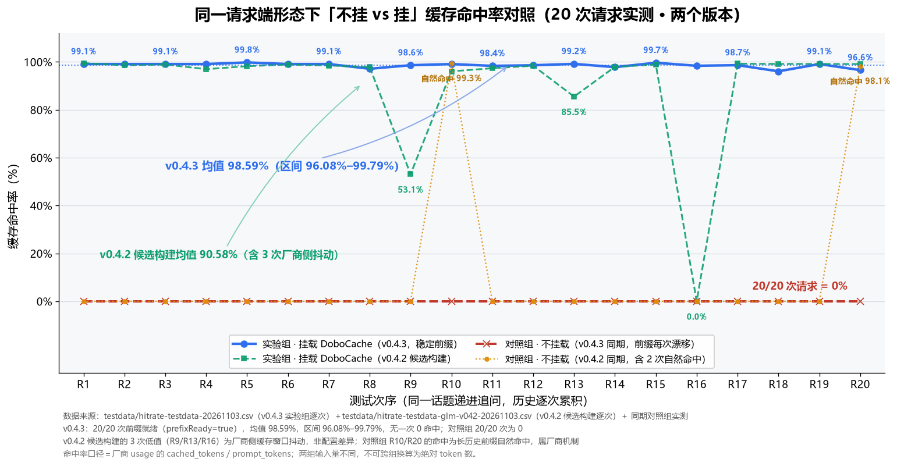
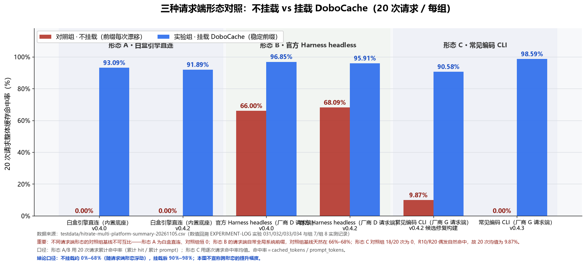

**[简体中文](https://github.com/dobo123123/dobocache/blob/main/README.md) · [English](https://github.com/dobo123123/dobocache/blob/main/release/README.en.md)**

---

# DoboCache v0.5.2 · dobostitch：同一缓存内核，两种挂法

> **同一个会话，别为同一段上下文反复付全价。**
> 把请求前缀稳定下来，让你已经在付费的**厂商前缀缓存（prompt caching）**真正命中：第一次请求照常建缓存，从第二次起基本按缓存价走。全程本地运行，不联网、不上报。

### 先说你是不是碰到过这三种情况

| 症状 | 真实原因 |
|---|---|
| 同一个会话越问越贵 | 前缀一变，厂商那段缓存**整段作废**，后面每次都在全价重算 |
| 长会话突然"忘事"、答非所问 | 客户端自动压缩或裁剪切掉了历史，切完的前缀对不齐缓存块边界 |
| 换客户端 / 改了提示里的一个字，命中率直接归零 | 头部的时间戳、随机 ID、工具数组顺序不稳，前缀第一段就变了 |

这三件事不是"模型不行"，也不全是厂商缓存不行——**卡点只有一个：前缀稳不稳。** 厂商缓存本身很好用，前缀稳的时候能吃到接近 99%；DoboCache 做的是把这件"靠运气"的事变成每次请求都发生，并且把每一步做了什么写成本地日志，让你能自己核对，而不是只看一个漂亮数字。

### 30 秒上手（不用 MCP、不改客户端代码、一条命令）

```bash
npx -y dobocache@0.5.2 dobostitch start
```

终端会打印一行接入地址，形如 `接入 baseURL 填：http://127.0.0.1:27880/anthropic`（按你用的厂商换成 `/openai` 或 `/deepseek`）。把这行填进客户端的 **baseURL**，密钥、模型名、请求内容一个字都不用动，然后照常提问——终端会出现一张体检卡，**从第 2 轮请求起**卡上就有命中百分比。

想知道它活着没有：

```bash
curl http://127.0.0.1:27880/__dobostitch/health     # 期望返回 {"ok":true,...}
```

- 已解压发布包：双击 `start-dobostitch.cmd` 即可（Windows，无需 `npm install`）
- 完整四步、端口顺延规则、可选参数（`--port` / `--rewrite` / `--inject-usage` / `--token`）→ [§六 · 写法 D](#写法-ddobostitch-本地代理不用改客户端代码)
- 完全没接触过命令行 → [零基础三分钟上手](https://github.com/dobo123123/dobocache/blob/main/release/零基础三分钟上手.md)，从装 Node 到验证成功六步走完
- 你的客户端支持 MCP？也可以走 MCP Server 形态（`dobocache`，9 个工具），见 [§六 写法 A/B/C](#六安装与挂载四种写法abc-是-mcp-挂载d-是本地代理)

### 挂上去能到什么水平（带条件，不裸报）

代理形态（写法 D）实测，同一份约 1.4 万 token 系统提示 + 12 个工具定义，两臂字节级同源，取**第 2 轮**：

| 场景 | 直连 | 经代理 |
|---|---|---|
| 提示里含"当前时间：…"，两轮取值不同 | 0.00% | **98.85%** |
| 字段顺序与工具数组顺序被打乱 | 87.39% | **98.98%** |
| 两轮请求体完全相同（已经很稳） | 98.99% | 98.99% |

三句话把边界讲清：数字只在**同一厂商、同一份提示、第 2 轮**成立；"提升 98.85 个百分点"不等于"命中率提升了 98.85%"；提示本来就稳定时它**不带来增量，也不会让结果变差**。不折算金额，原始数据与复跑脚本随包提供 → [§六·写法 D 实测表](#写法-ddobostitch-本地代理不用改客户端代码)

### 装之前需要知道的三件事

1. **免费、开源、无付费版**：Apache-2.0，没有订阅、没有商业授权门槛；
2. **数据不出本机**：不装证书、不解密 TLS、不上报；日志里没有你的提问原文（`req-<hash>` / `sid-<hash>`），只存本地；
3. **平台验证程度如实标注**：Windows 真机端到端已验证；Linux 容器已实测；macOS CI 冒烟已通过（桌面客户端长会话未实测）。不写"完整支持"、不做成功率承诺 → [平台支持状态](#平台支持状态装之前先看这一节)

---

DoboCache 是一个以 **stdio 方式挂载的 MCP Server**，作用是在你已有的编码 CLI / Agent 客户端和模型厂商 API 之间，把每一次请求的上下文整理成**稳定、可复用、过长会自动补足**的前缀，从而让厂商的**前缀缓存（prompt caching）**真正命中；命中与否、命中多少、哪一步做了调整，全部写进本地白盒日志并可随时查询。

### 两种形态，同一套内核（v0.5.0 起）

同一个缓存内核，两种用法，**选一种装就行，不用都装**：

| 形态 | 命令 | 怎么用 | 适合谁 |
|---|---|---|---|
| **A. MCP Server**（原有形态，保留不变） | `dobocache` | 在客户端的 MCP 配置里挂一个 stdio server，由客户端调用 `cf_*` 系列工具 | 客户端支持 MCP、希望由 Agent 自己决定何时整理前缀 |
| **B. 本地代理 `dobostitch`**（v0.5.0 新增） | `dobostitch start` | 在本机起一个本地代理，把客户端的 `baseURL` 改成代理地址，请求自动过一遍 | 想"装上就能用"、不想改客户端代码的人 |

两种形态共用同一套命中判定、同一套白盒卡片、同一套日志口径，区别只在**谁触发**：形态 A 靠客户端调用工具，形态 B 靠请求自然流经代理。
形态 B 的接入步骤见 [§六 · 写法 D](#写法-ddobostitch-本地代理不用改客户端代码)。

> 形态 B 不装证书、不解密、不上报，密钥仍在你自己的配置文件里；它的默认改写档位是 `stabilize`（规范化 + 工具顺序重排）。`anchor` 是**实验档**，会让模型看到的时间停在会话开始那一刻，详见 [§十 已知限制](#十已知限制与不承诺项)。

### 先看硬数据：20 次连续请求对照（同一台机器、同一后端模型、同一套参数，只区分挂没挂）

| 请求端形态 | 20 次请求 · 不挂载 | 20 次请求 · 挂载 DoboCache |
|---|---|---|
| **COD-X**：Codex 系编码 CLI（后端模型 **GLM**，即「厂商 G」） | **0.00%**（20/20 次全为 0） | **98.59%**（区间 96.08% – 99.79%，20/20 次命中） |
| **DSH**：DeepSeek 官方 Harness headless（后端模型 **DeepSeek**，即「厂商 D」） | 66.00%（这 66% 全部来自它自带的约 2,560 tokens 系统前缀） | 96.85% |
| **WBX**：本工具自研白盒直连（不做任何前缀处理） | 0.00%（结构性零基线：这个请求端本来就没有前缀可命中） | 93.09% |

> 读法只有一条：**同一形态内部横着比「挂 vs 不挂」**。跨形态的对照组不可互比——对照组的高低由请求端自己有没有前缀处理决定，与 DoboCache 无关。
> 逐次 usage、任务原文、复跑脚本全部随包提供，任何一行都能自己复算 → [§四 实测数据](#四实测数据20-次连续请求对照)

---

> **官方入口声明**
> DoboCache 的官方代码仓库只有 <https://github.com/dobo123123/dobocache> 一处，官方发布物只在它的 Releases 页面。
> 在其他渠道看到同名项目、同名服务或付费版本，均非官方出品。本项目免费，不通过任何第三方平台售卖。

> **第一次用？请先看 [零基础三分钟上手](https://github.com/dobo123123/dobocache/blob/main/release/零基础三分钟上手.md)** —— 从装 Node 到验证成功，六步走完，不用懂原理。
> 装的过程中报错，直接翻 [FAQ 的「安装报错速查」](https://github.com/dobo123123/dobocache/blob/main/release/FAQ-使用须知.md#安装报错速查装不上先看这一章)，按报错原文查。
>
> 装不上、配不通、不知道怎么写配置？先看上面的 FAQ；还不行就到 [Discussions](https://github.com/dobo123123/dobocache/discussions) 提问（安装类问题不用开 Issue）。


## 平台支持状态（装之前先看这一节）

DoboCache 是纯 JavaScript 的 stdio MCP Server，包内**不含任何原生二进制**（`.node` / `.exe` / `.dll` 数量均为 0），因此不存在 ABI 层面的平台锁定。但"**能跑**"和"**验证过**"是两件事，本版按实际验证程度如实标注：

| 平台 | 状态 | 验证到什么程度 |
|---|---|---|
| **Windows 10 / 11（x64）** | ✅ **主打平台，已真机验证** | 真机端到端跑通：本组实验 20 次连续请求对照（含真实 MCP 客户端挂载 + 厂商 usage 校验）、便携包解压即跑冒烟、全量 **95 项**测试通过、日志落盘实测 `%LOCALAPPDATA%\DoboCache\logs` |
| **Linux（x86_64）** | 🟡 **容器环境已实测**（非桌面真机） | 2026-11-04 在 Docker `linux/amd64` + Node 官方 Linux 镜像内对发布包做真实运行：解压即跑、`initialize`/`tools/list` 返回合法、9 个工具全在、`cf_judge` 命中、`cf_inject` 返回 `prefixReady=true`、日志按 `~/.local/state/dobocache` 落盘、`XDG_STATE_HOME` 生效、`DOBOCACHE_LOG_DIR` 优先级最高、只读目录降级不崩溃、Node 16 自检 `exit 1`。**桌面 Linux 真机 + 图形客户端挂载、arm64 仍未验证**（细节见 [`兼容性说明.md`](https://github.com/dobo123123/dobocache/blob/main/release/兼容性说明.md) 附录 A） |
| **macOS（Apple Silicon / Intel）** | 🟡 **CI 真机冒烟已通过**（非长期使用验证） | CI 的 macOS job 在真实 Mac 机器上跑通：`npm ci` → `tsc` → `tsc --noEmit` → `eslint` → `vitest` → 首屏命令冒烟（入口转发 / 原 bin / MCP 主路径）→ MCP stdio 握手（`initialize` + `tools/list` 恰好 9 个工具）+ 日志目录断言（必须落在 `~/Library/Logs/DoboCache` 且 `logDirSource=platform`）。Apple Silicon（`macos-latest`）与 Intel（`macos-13`）两个架构都在矩阵内，最近一次全绿见 Actions。**仍缺**：真实桌面客户端（如各类编码 CLI）挂载后的长会话实测 |

> **一眼结论**：想省事就按 Windows 装（真机端到端验证过）；Linux / macOS 能跑但只做到上面写的程度，不吹"完整支持"。下面折叠里的每一档验证内容、反馈渠道和边界说明，**遇到问题再展开**。

<details>
<summary>展开：每一档验证到什么程度、怎么反馈、边界说明</summary>

**我们把边界说清楚**：

1. Windows 是主打平台，也是**唯一**做过真机端到端验证（真实客户端挂载 + 厂商 usage 回读）的平台；
2. Linux 已在 `linux/amd64` 容器环境做过真实运行验证（协议链路 + 日志 + 只读降级 + Node 版本自检），但**桌面发行版的图形客户端挂载、arm64 仍未验证**；macOS 侧 CI 已在 Apple Silicon 与 Intel 真机跑通冒烟链路，但**没有做过桌面客户端的长时间会话实测**。因此 macOS 只写"CI 冒烟已通过"，Linux 只写"容器已实测"，都不写"完整支持"；成功率我们没有真实数据，不做任何百分比承诺；
3. **欢迎反馈后修**：在 Linux / macOS 上跑通或跑挂，都请反馈。我们不把这些平台当作"理论上没问题所以不用管"。

**反馈渠道**

| 渠道 | 怎么用 |
|---|---|
| GitHub Issues（推荐） | 标题带 `[platform: macOS]` 或 `[platform: linux]`；正文附 `node -v`、`uname -a`（macOS 用 `sw_vers`）、`cf_report` 返回的 `logDir` / `logDirSource`、完整报错原文 |
| 私下联系（非公开） | 安全类问题请走 [`SECURITY.md`](https://github.com/dobo123123/dobocache/blob/main/SECURITY.md) 的私下上报渠道（GitHub Security Advisories），**不要**在公开 issue 中披露；一般问题走 Issues 即可。本项目当前不公开电子邮件地址，以避免维护者个人邮箱被骚扰、撞库或用于社工攻击 |
| 自查（反馈前先看） | `release/FAQ-使用须知.md` §三（日志在哪）与 §七（`prefixReady=false` 怎么办），可解决大部分"看起来没生效"的问题 |

> **反馈时不要把提问原文粘进 issue**：日志已脱敏（`req-<hash>` / `sid-<hash>`），贴日志片段足够定位问题。

</details>

---

## 一、它解决什么问题

现代厂商 API 都提供前缀缓存：请求开头部分如果与上一次完全一致，这部分 token 按缓存价计费，不再全价重算。但真实对话里前缀经常"差一点点"：

- 系统提示词顺序不稳定、拼接顺序每次不同；
- 历史消息被裁剪后长度对不齐缓存块边界（常见是 128 token 对齐）；
- 前缀长度小于厂商的最小缓存门槛，压根不进入缓存；
- 重复指令、重复文档块让前缀越来越长却越来越脏。

任何一处不一致，缓存就整个失效——**你以为在用缓存，其实一直在全价重算**。DoboCache 就是把这些"差一点点"逐条修掉，并且**把每一步的调整原因写清楚**，让你能自己核对而不是只看一个漂亮数字。

## 二、九个可调用的工具（8 个业务工具 + 1 个 `ping` 健康检查）

server 共暴露 **8 个业务工具 + 1 个健康检查（`ping`）**，均为 stdio 本地调用，不联网、不上传：

| 工具 | 作用 | 是否写盘 |
|---|---|---|
| `cf_judge` | **命中判定**：关键词分层（实体锚词/意图修饰词）→ 三层匹配 → 时效衰减 → 负向过滤，输出可解释证据（`hit` / `score` / `evidence` / `matched`） | 记白盒日志 |
| `cf_tier` | **价值分级准入**：提纯去噪 → A/B/C 分级 → 按预算从高到低填充，输出准入列表与丢弃明细 | 否 |
| `cf_inject` | **记忆提纯注入**：把上下文整理成稳定前缀（去重 → 128 token 对齐 → 过门槛补足），返回可直接发送的 `prefix` / `tail` | 记白盒日志、冻结会话前缀（内存） |
| `cf_warmup` | **预热**：正式请求前显式调用一次，用冻结前缀构造最小占位请求，触发厂商前缀缓存建立（会产生少量计费，需自行发一次 LLM 请求） | 否 |
| `cf_report` | 白盒累计统计：累计命中率、原始/优化 token、按会话聚合（`per_session`），并回传日志实际落点 `logDir` / `logDirSource`；加 `source="disk"` 时改为**从本地日志重新聚合**（跨进程、跨天累计，客户端重启不清零），`days=<n>` 限定只读最近 n 天 | 否（读日志） |
| `cf_meter` | 请求计量快照（token 计数与计价相对值，不含任何请求正文） | 否 |
| `cf_prune` | 工具输出确定性修剪：去重行、压缩空白、行数/字符数双上限，返回修剪前后体积比 | 否 |
| `cf_normalize` | 结构化结果归一：字段裁剪 + 稳定排序，返回不含原文的键值（`nk-<16 位 hash>`） | 否 |

典型参数：`cf_inject(reset=true, sessionId=<你的会话标识>, minPrefixTokens=<目标厂商门槛>)`。

> 参数在协议层做类型与范围校验（如 `threshold ≥ 0`、`topK ≥ 1`、`maxChars ≥ 1`、`maxTokens > 0`），越界会返回标准 `-32602` 校验错误并指明字段，不会静默生效。

## 三、版本说明（请先读这一节）

**v0.5.2 = 首屏命令修复版。缓存核心仍零改动。** 上一版（v0.5.1）发布后被复验出一处真错误：文档给出的第一屏命令 `npx dobocache@0.5.1 dobostitch start` 会**起来一个 MCP server 然后挂住不动**，代理根本没启动——因为包里有两个 `bin`，`npx` 只挑同名那个跑，入口又不看后面的参数。本版让入口自己认参数：遇到 `dobostitch` 就转交代理，其余情况照旧起 MCP。**同时把代理形态在 `npx` 下的正确写法写进文档并用守卫脚本锁住，不再靠人记。**

| 项目 | 说明 |
|---|---|
| 最该知道的一句 | 你之前照着写 `npx dobocache@0.5.1 dobostitch start` 起不来，**不是你的错，是本版的锅**。升到 `0.5.2` 后同一条命令可直接用；若不想升级，旧版请改用 `npx -p dobocache@0.5.1 dobostitch start` |
| 修复范围 | `src/index.ts` 增加入口转发：`argv[2] === "dobostitch"` 时把后续参数原样交给代理 CLI；`src/proxy/cli.ts` 导出可复用的启动函数。9 个工具的名称、入参、返回结构**一个没改** |
| 交接目录 | 代理的会话交接目录从「包目录内」改到**平台数据目录**（Windows `%LOCALAPPDATA%\DoboCache\handoff`，macOS `~/Library/Application Support/DoboCache/handoff`，Linux `$XDG_DATA_HOME/dobocache/handoff`），并在首次启动时自动迁移旧目录里的会话（本机实测迁移 43 个）。**原先写在 `node_modules` 里的记录不再产生** |
| 文档与守卫 | 4 份文档的代理启动写法统一订正；`scripts/check-docs.mjs` 新增 npx 写法守卫，出现 `npx dobocache@x.y.z dobostitch` 这种错配直接报 ERROR |
| 首屏冒烟 | 新增 `scripts/smoke-firstrun.mjs`（`npm run smoke`）：断言 ① 入口转发能起来 ② 原 `dobostitch` bin 不受影响 ③ MCP 主路径仍正常握手，已接入 CI |
| CI | 矩阵按平台独立超时，`macos-13`（Intel）不再被固定超时连带取消 |
| 校验 | 本次实跑：`tsc --noEmit` 零报错、`eslint src test` 零告警、`vitest` **95/95** 通过、`npm run smoke` **3/3 PASS**、`check:docs` 0 ERROR / 0 WARN |
| **不宣称** | 缓存内核、命中率与 v0.5.1 完全一致，**不是性能版**。本版只修「命令起不来」和「记录写进 node_modules」这两件事 |

**v0.5.1 = 双形态打通版（文档、双击入口、元数据三处补齐）。缓存核心零改动。**（文档、双击入口、元数据三处补齐）。缓存核心零改动。** v0.5.0 上线后有一处落差：文档里承诺"解压后双击 `start-dobostitch.cmd` 即可"，但便携包里其实没有这个文件，代理形态的所有说明也只能靠 `npx` 一条命令摸索。本版把这条路补平——**新增双击即启动的入口**，并把两种挂法的说明在四份文档里对齐。

| 项目 | 说明 |
|---|---|
| 新增文件 | `start-dobostitch.cmd`（便携包根目录）：双击即启动本地代理，窗口直接打印"接入 baseURL 填什么"，退出用 `Ctrl+C`。纯 ASCII 批处理，不依赖代码页，Windows 任何语言环境都不会乱码 |
| 文档补齐 | `release/零基础三分钟上手.md` 新增「分岔口：先选一条路」与「路线 A：代理三步走」——不改配置文件走完代理形态，并标注该路线**不需要**做后面的第 3–6 步；`release/FAQ-使用须知.md` 新增「十五、代理形态专项排障」10 条（双击闪退 / 端口顺延 / 401 / 404 / `stream_options` 400 / 卡片停在 0 次 / 「未回传 usage」/ 与 MCP 能否同装 / 关掉后恢复 / 局域网与 token）；中英社区帖各增一节「两种挂法」 |
| 元数据订正 | `package.json` / `server.json` / `src/index.ts` 的版本字段与 `CHECK_DOCS` 已知版本表统一到 `0.5.1`，此前 `src/index.ts` 内嵌版本落后于包版本，冒烟断言会读到旧值 |
| 校验 | 本次实跑：`tsc --noEmit` 零报错、`vitest` **95/95** 通过、`test:rewrite` / `test:inject` 通过、MCP stdio 冒烟全断言通过（`platform=win32`、9 工具齐全）、`check:docs` **0 ERROR / 0 WARN**；代理真机起停复检：`/__dobostitch/health` 返回 `ok:true` 且三路由齐全，双击入口实跑可正常起代理并打印体检卡 A |
| 未改动 | 缓存核心（前缀冻结 / 128 对齐 / 分级准入 / 判定逻辑）**一行没动**，MCP 侧 9 个工具的名称、入参、返回结构不变；命中率数字与 v0.5.0 一致，**本版不是性能提升版** |
| 平台 | 代理形态仍为 **Windows 11 真机验证**；Linux / macOS 代理形态未验证，不在承诺范围 |
| **不宣称** | 不宣称"更快 / 更强 / 优于上一版"。本版只解决"文档承诺了、包里没有"的落地缺口 |

---

**v0.5.0（上一版）= 双形态版（新增「本地代理」用法）。** 客户端不需要支持 MCP、也不用改一行代码，只要把 `baseURL` 指向本机起的代理，请求就会经过同一套前缀整理与命中判定；原有的 MCP Server 形态、9 个工具的定义与返回格式**全部保留不变**。本版只增加了一种用法，不代表命中行为发生变化。

| 项目 | 说明 |
|---|---|
| 新增用法 | `dobostitch start` / `status` / `resume` / `doctor` 四个子命令；本地代理默认监听 `27880`（占用时逐个 +1 后跳，最多 10 次），按 `anthropic` / `openai` / `deepseek` 三条路由转发；`GET /__dobostitch/health` 可探活；每次请求输出一张体检卡 |
| 新增观测 | 体检卡 A（即时摘要：命中率、输入/命中/未命中 token、这一步做了什么）、前缀诊断（第几段起变化 / 被裁掉多少段）、`data/handoff` 会话交接摘要 |
| 未改动 | MCP Server 侧 9 个工具（`ping` + 8 业务工具）的名称、入参、返回结构；默认档位下 `cf_judge` / `cf_inject` 仍只返回 JSON、不含卡片；日志路径与脱敏规则不变 |
| 默认档位 | 代理默认 `--rewrite stabilize`（规范化键序 + 工具数组重排）、`--inject-usage on`。`--rewrite off|observe|anchor` 可选，`anchor` 属实验档 |
| 平台 | 代理形态当前**只在 Windows 做过真机端到端验证**；Linux / macOS 未做真机验证，不在本版承诺范围内 |
| **不宣称** | 不宣称"更快 / 更强 / 优于上一版"。命中率数字全部来自 §六·写法 D 的实测表，且只在表中列出的场景、轮次与条件下成立 |

---

**v0.4.9（上一版）= 发布通道切换版。npm 已公告自 2027-01 起限制「可绕过 2FA 的长寿命 token」直接发布，本版把发布通道整体切到 GitHub Actions OIDC Trusted Publishing：打 tag 时由 GitHub 签发短期令牌、npm 侧校验后直接收包，仓库与其设置里不再存放任何发布密钥，产物附带 provenance 签名、可追溯到具体 commit 与工作流运行。代码与缓存核心零改动，行为与 v0.4.8 逐字节一致。**

| 项目 | 说明 |
|---|---|
| 承接 | v0.4.7 的日志边界（单文件 10MB 轮转 + 默认保留 7 天）、`cf_report` 的 `source="disk"` 读盘聚合、`cf_prune` 口径澄清全部保留；更早的 v0.4.4 `minPrefixTokens` 修复与日志隐私脱敏（`requestId` → `req-<8 位 hash>`；`sessionId` → `sid-<8 位 hash>`；`cf_normalize` 键 → `nk-<16 位 hash>`）也仍在 |
| 本版改动 | ① **对照图不再破图**：两张对照图（命中率对照 / 三种请求端形态）改用 `raw.githubusercontent.com` 绝对地址，npm 包页面可直接显示出来；② **文档链接不再 404**：根 README 里 9 处指向包内文档的相对链接（零基础上手 / FAQ / 兼容性说明 / SECURITY / LICENSE / 英文版 / 中文版）改为 GitHub 绝对地址，在 npm 页面上点击即可跳转；③ **便携包内文档保持原样**：`release/README.zh.md`、`README.en.md` 继续用同目录相对路径——包内文档与图同目录，解压后离线也能看，两套路径各司其职 |
| 命中相关代码 | **无代码改动**。缓存核心（前缀冻结 / 对齐 / 分级准入 / 判定逻辑）与 v0.4.7 一致，`dist` 行为逐字节相同，仅 `serverInfo.version` 随版本号更新；默认档位下 `cf_judge` / `cf_inject` 返回**只有一段 JSON、不含卡片** |
| 冒烟验证 | MCP stdio 冒烟通过（2026-11-07 本机 win32 实跑）：`serverInfo.version = 0.4.9`、`protocolVersion = 2024-11-05`、9 工具齐全（`ping`/`cf_judge`/`cf_tier`/`cf_inject`/`cf_meter`/`cf_warmup`/`cf_report`/`cf_prune`/`cf_normalize`）、`cf_judge` 真实调用落盘成功（`dobocache-2026-11-07.log.jsonl`）、`cf_report` 返回 `logDir` / `logDirSource`（实测 `calls=1`、`hitRate=80`） |
| 测试 | **95 / 95 通过**；`tsc --noEmit` 零报错；`eslint src test` 零告警 |
| 平台验证 | **Windows 真机端到端已验证**；**Linux 已在 `linux/amd64` 容器内实测运行**（协议链路 / 9 工具 / 日志分支 / 只读降级 / Node 版本自检，见「平台支持状态」与 `release/兼容性说明.md`）；macOS 侧 CI 在 Apple Silicon 与 Intel 真机跑通冒烟链路（握手 / 9 工具 / 日志目录 / 构建与单测），**桌面客户端长会话未实测** |
| **不宣称** | 本版**不是性能提升版，也不是功能版**。命中率与 v0.4.7 / v0.4.4 完全相同，请勿把本文任何数字读成「新版本更高」 |

> 为什么会有 v0.4.3：v0.4.2 正式包里，`injectIncremental` 第 4 步 `topUpPrefixToMin(...)` 之后缺少 `prefix = topUp.prefix;`，导致补足结果没有接回、参数形同虚设。DeepSeek 系默认门槛低（295），正常前缀本就够长，所以一直没暴露；GLM 系真实门槛 1806+，必须靠补足才能过线，一补不上立刻露馅——这就是回归用 GLM 系做回归的原因。v0.4.3 补上了这一行。

## 四、实测数据（20 次连续请求对照）

本组实测：同一套 20 次递进式连续话题。请求端为 **COD-X**（Codex 系编码 CLI），后端模型接 **GLM**；白盒引擎以 stdio MCP 挂载 DoboCache；同一台机器、同一后端模型、同一套参数，只区分"挂载 / 不挂载"。这一形态**一共跑了两轮完整 20 次**（组 7 / 组 8），两轮挂的是不同版本——逐轮对比见本节末「两轮 20 次同口径复跑」。

> **代号一览（写成能认出来的样子，不做过度匿名）**
>
> | 代号 | 是什么 | 后端模型 |
> |---|---|---|
> | **WBX** | 本工具自研的白盒直连请求端（不是任何官方客户端），故意不做任何前缀处理，专门用来测零基线 | — |
> | **DSH** | **DeepSeek 官方 Harness** 的 headless 模式 | **DeepSeek** |
> | **COD-X** | **Codex 系编码 CLI** | **GLM**（智谱） |
>
> 早期档案里把模型厂商记作「厂商 D」（DeepSeek）/「厂商 G」（GLM），本文起统一写成厂商名本身，读表时不必再猜。表中只报**命中率与相对比例**，不报任何金额；成本相关字段按 §六 的计价系数折算相对值。



| 指标 | 对照组（不挂载） | 实验组（挂载 DoboCache） |
|---|---|---|
| 20 次请求命中率均值 | **0.00%**（20/20 次全为 0） | **98.59%** |
| 区间 | — | **96.08% – 99.79%** |
| 零命中请求数 | 20 / 20 | **0 / 20** |
| 前缀就绪（`prefixReady=true`） | — | **20 / 20** |
| 实际生效门槛 `effectiveMinPrefixTokens` | — | **3450**（= 3000 × 1.15，配置已生效） |

### 为什么对照组读到 0 —— 因果链就三句话

1. **每轮请求的头部都被注入了不同的随机噪音**，所以两轮之间开头的第一段就不一样；
2. 厂商前缀缓存只认"与上一次完全一致的开头"，**开头一变，已建立的那段缓存整段作废**，本次请求从头到尾都按未命中算；
3. 20 轮里每一轮都这样漂移，于是 20/20 次读数都是 0，均值自然 0.00%。

所以这 0 不是"厂商缓存不行"，也不是"对照组被故意做坏"，而是**前缀不稳时前缀缓存的真实表现**。本组的 0 与 WBX 的 0 成因不同：WBX 是**结构性零基线**（那个请求端干脆不做任何前缀处理，天生没有可命中的前缀）；COD-X 组是**噪音压力下的零**（前缀本来可以有，被漂移打散了）。两者都不是 DoboCache 的作用结果，只有同一形态里"挂 vs 不挂"的差才是。

关键读法，请连同三条一起看：

1. **对照组每次都注入了不同的随机噪音**制造前缀漂移，所以 20 次全 0——这不是"对照组很差"，而是"前缀一变，厂商前缀缓存就整段失效"的真实写照；
2. **实验组 20 次全部命中**，前缀 `prefixTokens` 稳定落在 3456–4480，每一次 `prefixReady` 均为 true；
3. **命中率是单次请求输入内部的缓存命中占比，不是绝对 token 节省量**。两组输入量本就不同（对照组输入随请求次数从 39 累积到 2738 tokens，实验组稳定在"前缀 + 尾部"），因此不可跨组直接换算成绝对 token 数，也不要在不同实验之间横向混比。

**把视角拉高一层：不挂载并不总是 0%。** 命中率不是只由"挂不挂"决定，请求端自己怎么构造请求，决定了对照组的起点。同一套挂载逻辑换到三种请求端形态各跑 20 次：

**先把三个请求端分别是什么讲清楚——对照组起点之所以差这么多，全在这里：**

| 形态 | 请求端是谁 | 请求端自身是否做前缀处理 | 对照组为什么是这个数 |
|---|---|---|---|
| A · WBX 白盒自研直连 | **DoboCache 自研的白盒测试底座**（为跑对照实验自己写的直连请求端，不是任何官方客户端） | **不做，一点都没做**：不构造前缀、不预热缓存、不复用会话，每轮只发「任务原文 + 随机噪音」 | 20 次累计命中 0 / 28,846 tokens。请求端手里没有任何可复用的前缀，基线因此恒为 **0.00%**，属**结构性零基线**，不是"缓存被打崩" |
| B · DSH DeepSeek 官方 Harness headless | DeepSeek 官方客户端（headless 模式），后端模型 DeepSeek | **做，且由客户端与厂商侧共同保证**：每次新会话固定注入约 2,560 tokens 的厂商全局系统前缀 | 20 次累计命中 51,200 / 77,576 tokens = **66.00%**；51,200 正好等于 2,560 × 20，可自行验证这 66% 全部来自官方前缀，与 DoboCache 无关 |
| C · COD-X Codex 系编码 CLI | Codex 系编码客户端，后端模型 GLM（智谱） | **不固定**：无全局系统前缀，只有历史长前缀恰好稳定时才偶发命中 | 组 8 全 20 次为 0；组 7 仅 R10 / R20 自然命中，逐次均值 9.87% |

一句话讲明白：**A 的 0% 是"这个请求端本来就没有前缀可命中"（我们自己搭的底座，故意什么都不做，用来测零基线）；B 的 66% 是"官方客户端自带前缀垫在下面"。两者都不是 DoboCache 的作用结果。** 这三个起点只说明一件事——对照组的高度由**请求端自身的前缀处理能力**决定。所以本表只能横着读同一形态内的「挂 vs 不挂」，不能竖着比"谁的对照组更高"，更不能把跨形态百分比相减当作本方案的提升幅度。




| 请求端形态 | 版本 · 实验来源 | 对照组（不挂载） | 实验组（挂载） | 说明 |
|---|---|---|---|---|
| A · WBX 白盒自研直连 | v0.4.0 · 实验 031 | 0.00% | 93.09% | 自研白盒底座，未做任何前缀处理（结构性零基线） |
| A · WBX 白盒自研直连 | v0.4.2 · 实验 032 | 0.00% | 91.89% | 同上 |
| B · DSH DeepSeek 官方 Harness | v0.4.0 · 实验 033 | 66.00% | 96.85% | 请求端自带约 2,560 tokens 全局系统前缀缓存；对照组随噪音累积由 84.27% 劣化到 54.54% |
| B · DSH DeepSeek 官方 Harness | v0.4.2 · 实验 034 | 68.09% | 95.91% | 同批对照组基线同样来自厂商系统前缀缓存；实验组每轮未命中压至 135–426 tokens |
| C · COD-X Codex 系编码 CLI（后端 GLM） | v0.4.2 候选修复构建 · 组 7 | 9.87% | 90.58% | 对照组 18/20 次为 0，R10/R20 因长历史前缀自然命中 |
| C · COD-X Codex 系编码 CLI（后端 GLM） | v0.4.3 · 组 8 | 0.00% | 98.59% | 即上表本组主数据 |

三条读法：

1. **形态 B 的 66%–68% 不是 DoboCache 的功劳，也不是"提升幅度小"**——那是请求端自己就挂了全局系统前缀缓存，对照组天生占便宜；而它随噪音累积一路劣化（84.27% → 54.54%），恰恰说明这种请求端的缓存同样脆弱；
2. **三种形态的对照组起点从 0% 到 68%，差别全在请求端怎么构造请求，跨形态的对照值不可互比**；唯一可比的是同一形态内部的"挂 vs 不挂"；
3. **挂载后三种形态都落在 90%–98%**，说明"静态前缀复用"这件事与请求端形态无关，不是某一家请求端的特例。
4. **口径提醒（比数字本身更要紧）**：形态 A / B 是「20 次请求累计口径」（累计命中 tokens ÷ 累计 prompt tokens），形态 C 是「20 次逐次请求命中率的均值」——两种统计算法不同，跨形态只能看量级，不能拿百分比互相加减；同一形态内部的「挂 vs 不挂」才是同口径对比。

### 两轮 20 次同口径复跑：后一版强在哪

COD-X 这一形态**跑了完整两轮，每轮 20 次**，两轮只差挂载的版本——这是本项目唯一一组「同形态、同任务、不同版本」的对照：

| 轮次 | 挂载版本 | 对照组（不挂载） | 实验组（挂载） | 20 次里出现异常读数的次数 |
|---|---|---|---|---|
| 组 7 | v0.4.2 候选修复构建 | 9.87% | 90.58% | 3 次（53.08% / 85.53% / 0.00%） |
| 组 8 | **v0.4.3** | 0.00% | **98.59%**（96.08% – 99.79%） | **0 次** |

两轮的对照组构造完全一样（每轮开头注入不同随机噪音，故意让前缀漂移），所以「组 7 = 9.87%、组 8 = 0.00%」**不是"版本越高、不挂载越差"**，只是噪音本身的随机性：

- 组 7 里 R10、R20 两次，历史已累积到 10 轮 / 19 轮，长历史前缀足够长，厂商侧缓存自己对上了，读到 **99.27% / 98.10%**；其余 18 次被打散读 0，20 次平均才 9.87%；
- 组 8 那 20 次的噪音把前缀全部打散，次次为 0，均值 0.00%。

**那么"后一版更强"强在哪——三件具体的事，都不是把均值往上抬：**

1. **抖动清零**：组 7 的 20 次里有 3 次被厂商侧抖动打到 53.08% / 85.53% / 0.00%；组 8 的 20 次**一次抖动都没有**，`prefixReady` 20/20，区间收在 96.08% – 99.79%；
2. **下限抬升**：最差的一次读数从 **0.00%** 抬到 **96.08%**。缓存工具真正影响体验的是"偶尔一次完全没吃到"，这一项从有到无；
3. **真实缺陷被修掉**：v0.4.3 补回了 `injectIncremental` 里 `topUpPrefixToMin(...)` 之后缺失的 `prefix = topUp.prefix;`——补足结果之前根本没接回下游，参数形同虚设。DeepSeek 系默认门槛低（295），正常前缀本就够长，所以一直没暴露；**GLM 系真实门槛 1806+，必须靠补足才能过线**，一补不上立刻露馅。这也是本套回归一律挂在 COD-X + GLM 上跑的原因：它是最严的那道门。

同时把话说全：**剔除抖动轮次后，两版的稳定段是持平的**——组 7 剩下 17 次均值 **98.41%**，组 8 同位置剔除后 **98.57%**，只差 0.16pp。所以请不要把「90.58% → 98.59%」读成"版本升级带来 8 个点提升"；版本迭代真正在做的是**把"稳"从偶发变成每次、把"会掉到 0"变成"掉不下去"**，稳定段的命中水平既没注水，也没夸大。逐次对照见 `release/testdata/hitrate-regression-report-20261103.md` 第六节。

**这两个数还反过来说明一件对本工具"不算功劳"的事：厂商自带缓存本身很好用——只要前缀稳定，它能吃到接近 99%。** 全程的卡点只有一件事：前缀稳不稳。DoboCache 做的是把前缀稳定下来、让"稳"发生在每一次请求上，不是凭空制造命中。所以「不挂载 0%–9.87%」是**压力条件下的读数**，既不是"厂商缓存很差"，也不该被读成"挂上就从 0 涨到 98 个点"。

统一口径：**不挂载约 0%–68%（随请求端形态浮动），挂载后 90%–98%**。表中每一行都能落到实验档案的实测记录上（实验 031 / 032 / 033 / 034 与组 7 / 组 8），并与汇总 CSV 的 `source_exp` / `recompute_file` 字段一一对应：`release/testdata/hitrate-multi-platform-summary-20261105.csv`——形态 A / B 的分子分母以 token 列同表落盘，形态 C 为逐次均值、逐次数据在同目录，任一行都可自行复算。逐次曲线与重绘图脚本见 `release/scripts/hitrate-comparison.py`。本表不含任何估算值或取整凑数。

### 关于测试规模：一句实话

这套数据来自 8 组对照实验，正式组每组 20 次连续请求，另有两组 5 次、10 次的前期门槛探测。

但要先把边界讲清楚：**这些测试的单次请求体量都很小**——每轮输入是同一份 AI 资讯盘点话题，前缀几百到数千 tokens，任务原文与逐次 usage 都在 `release/testdata/`，谁都能自己算一遍。

**我们没有测「特别长的长任务」**：单轮上万 tokens 的长文档问答、整个代码库的分析、几十轮的超长会话，都不在样本里。缓存前缀复用在这种体量下是否一样成立，我们没测过，也不打算替它下结论。

如果你手上正好有这类长任务，欢迎自己挂上去跑一遍再回来说话——把逐次 usage 记下来，比我们的任何承诺都有用。这也正是我们把逐次数据、任务原文、复跑步骤全部放进包里的原因：**让你能自己验证，而不是只能信我们。**

## 五、白盒报告：每一步都看得见

每次 `cf_judge` / `cf_inject` 之后，白盒日志会记录这一步做了什么、为什么做、效果如何。下面是一条按当前口径（v0.5.2）输出的记录示例，内容与 v0.5.1 一致：

```json
{
  "requestId": "req-1b0ff98f",
  "ts": 1793709231484,
  "reqIndex": 2,
  "promptChars": 36,
  "rawTokens": 201,
  "optimizedTokens": 4096,
  "hitRate": null,
  "savedTokens": 0,
  "savedPct": 0,
  "changes": [
    {"kind": "align128", "label": "前缀 128-token 对齐：减少尾部部分命中", "detail": "追加 98 个对齐块"},
    {"kind": "topup",    "label": "前缀过门槛补充：达到最小有效缓存长度", "detail": "补充 63 块（高价值片段/文档块）"},
    {"kind": "scenario", "label": "首条请求或缓存为空：轻量约束放行自由回答"}
  ],
  "note": "cf_inject：原始 201 tokens → 优化后 4096 tokens（前缀 4096 + tail）；实际门槛 3450 tokens。",
  "sessionId": "sid-b6ca1662",
  "scenario": "first",
  "mode": "rebuild",
  "alignBlocks": 98,
  "prefixTokens": 4096
}
```

三类常用对照能力都在：**第几次请求**（`reqIndex`）、**是否同一提问**（`req-...` 相同即同一提问）、**每一步动了什么**（`changes[]` + `note`）。内容本身不落盘。

> 记录里 `hitRate` 为 `null` 表示**本次请求未判定**：`cf_inject` 处在注入阶段、请求尚未发出，且调用方没有把厂商返回的缓存 `usage` 回传给 DoboCache，本机就无法得知真实命中率——此时如实记 `null`（未判定），**不再写 0**。看到 `null` 不要读成"命中率 0%"：要得到可判定的命中率，请在 `cf_judge` / `cf_inject` 里带上 `hitTokens` / `missTokens`（取自厂商 `usage` 的 `prompt_cache_hit_tokens` / `prompt_cache_miss_tokens`）。累计统计用 `cf_report` 查看。详见 [`FAQ-使用须知.md`](https://github.com/dobo123123/dobocache/blob/main/release/FAQ-使用须知.md) 第一节。

### 白盒报告默认关闭（v0.4.6）

白盒报告卡片是**给你看的**，但它写进对话上下文就要**占 token**（每张约 300+ tokens，每次工具调用都可能带一张）。因此从 v0.4.6 起：

- **默认（`quiet`）**：报告只写本地日志，**不随工具返回**，不占对话 token；
- **想看累计数据**：随时调 `cf_report`，它读本机日志、**不产生额外 token**；
- **想看每次的详情**：设环境变量 `DOBOCACHE_WHITEBOX`：
  - `once` —— 下一次调用返回一次详情，之后自动回落 `quiet`（适合临时排查一次）；
  - `always` —— 每次调用都带详情（适合正在做对照实验，代价就是每张卡的 token）；
  - `quiet` —— 关闭（默认值，等价于不设）；
- **首次运行提示**：本机第一次跑时会给一条一次性提示（告诉你白盒在哪、怎么开），之后永不再出。

| 档位 | 是否随调用返回报告 | 占用对话 token | 适用 |
|---|---|:---:|---|
| `quiet`（默认） | 否，只写本地日志 | 无 | 日常使用 |
| `once` | 只返回一次，随后自动回落 `quiet` | 一次性 | 排查"到底有没有生效" |
| `always` | 每次都返回 | 每次约 300+ tokens | 做对照实验、需要逐次读数时 |

> 一句话：**平时不用管它；需要证据时用 `cf_report`（不花 token），需要看单次细节时再开 `once` / `always`。**

## 六、安装与挂载（四种写法：A/B/C 是 MCP 挂载，D 是本地代理）

> **赶时间、只想看一条路**：不想碰 JSON 配置、客户端支不支持 MCP 都无所谓的，直接跳 [写法 D](#写法-ddobostitch-本地代理不用改客户端代码)——一条 `npx -y dobocache@0.5.2 dobostitch start` 就够，剩下的只是把客户端的 `baseURL` 换成终端打印的那个地址。
> 下面写法 A / B / C 是 **MCP 挂载**路线，适合客户端已支持 MCP、且希望由 Agent 自己决定何时整理前缀的情况。

1. 从 [Releases](https://github.com/dobo123123/dobocache/releases/latest) 下载 `dobocache-v0.5.2-portable.zip` 并解压（内含 `dist`、`src`、启动脚本与校验清单。**代理形态（写法 D）零外部依赖，解压双击即可跑，无需 `npm install`**；MCP 形态依赖 `@modelcontextprotocol/sdk`，请走写法 B / C 从 npm 安装。包内不含任何原生 `.node` 二进制，换机器换平台不会因 ABI 不匹配崩掉）；**不想下载也可以用下文写法 B / C / D 从 npm 装**；
2. 在你所用客户端的 MCP 配置里加一个 **stdio** server（下面三种写法任选其一）；
3. 重启客户端，确认工具列表里出现 **9 个**（`ping` + `cf_judge` / `cf_tier` / `cf_inject` / `cf_warmup` / `cf_report` / `cf_meter` / `cf_prune` / `cf_normalize`）。少任何一个都说明 server 没起来，先看客户端日志里的 stderr。

> **前置条件**：Node.js **18 或更高**。进程启动时会自检，版本过低会直接打印一句中文提示然后退出（不会静默失效）。
> **通用建议**：配置里的路径一律填**绝对路径**——客户端拉起 server 时不继承你 shell 的当前目录与 PATH，只写 `node` 或相对路径是最常见的翻车原因。

### 写法 A：绝对路径 `node` + 入口 js（推荐）

Windows：

```json
{
  "mcpServers": {
    "dobocache": {
      "command": "C:\\Program Files\\nodejs\\node.exe",
      "args": ["D:\\<解压目录>\\dist\\index.js"]
    }
  }
}
```

macOS / Linux：

```json
{
  "mcpServers": {
    "dobocache": {
      "command": "/usr/local/bin/node",
      "args": ["/Users/<你>/dobocache/dist/index.js"]
    }
  }
}
```

- **适用**：便携包解压即用、内网/离线机器、客户端以非登录用户或非常规工作目录拉起。
- **怎么找 node 路径**：Windows `where node`；macOS / Linux `which node`（Homebrew 常见 `/opt/homebrew/bin/node`、`/usr/local/bin/node`；用 nvm 的请填具体版本目录下的绝对路径）。
- 该写法不需要 `npm`、不联网，跨机器最稳。

### 写法 B：`npx -y` 一次性运行

> ℹ️ **渠道说明**：写法 B / C 要求该版本已能从 npm registry 取到。若 `npm view dobocache` 返回 `404`（该版本尚未发布，或所用镜像尚未同步），请直接用写法 A（便携包）——功能、内容与日志行为完全一致，不需要改任何配置。
>
> 关于仓库内的 `server.json`：它是**提交给 MCP Registry 的条目描述文件**，其中 `packages[].registryType` 只有 `npm` / `pypi` / `oci` 等固定取值（schema 不存在"便携包"这个类型），因此 `identifier` / `version` 标注的是 npm 上的发布目标；若 npm 上暂时取不到该版本，一律以写法 A 为准。

```json
{
  "mcpServers": {
    "dobocache": {
      "command": "npx",
      "args": ["-y", "dobocache@0.5.2"]
    }
  }
}
```

- ⚠️ **Windows 上必须写 `npx.cmd`**（`"command": "npx.cmd"`）。npm 在 Windows 上只安装 `npx.cmd`，没有 `npx.exe`，客户端 `spawn("npx")` 会直接报 `ENOENT`——这是 MCP 客户端在 Windows 上最高频的报错。
- macOS / Linux 保持 `npx` 即可；若客户端用非登录 shell 拉起且 PATH 里没有 node，可写死绝对路径（如 `/usr/local/bin/npx`）。
- **适用**：希望自动跟随版本、机器可联网、不想手工解压。
- **前提**：该版本能从 npm 取到（`npm view dobocache@0.5.2 version` 能返回版本号）；取不到时改用写法 A。另外 `npx` 有本地缓存，升级后行为仍是旧的时，执行 `npm cache clean --force` 或改用写法 C。

### 写法 C：全局安装后直接调命令

```bash
npm install -g dobocache@0.5.2
```

```json
{
  "mcpServers": {
    "dobocache": {
      "command": "dobocache"
    }
  }
}
```

- ⚠️ **Windows 上同样注意扩展名**：写 `"command": "dobocache.cmd"`；若客户端仍找不到命令，直接填全局安装目录下的绝对路径（`npm root -g` 显示的目录的上一级里的 `dobocache.cmd`）。
- **macOS / Linux 权限报错时**：`npm install -g dobocache@0.5.2 --prefix ~/.npm-global`，配置里填 `/Users/<你>/.npm-global/bin/dobocache` 绝对路径。
- **适用**：一台机器长期固定使用、不想每次下载。升级时重跑 `npm install -g dobocache@<新版本>` 并重启客户端。

三种写法对照：

| 写法 | 需要联网 | 需要 npm | 路径可控性 | 升级方式 | 适用场景 |
|---|:---:|:---:|---|---|---|
| A 绝对路径 node | 否 | 否 | 最高（自己写死） | 换包目录/改配置 | **推荐**：便携包、离线、内网 |
| B `npx -y` | 是 | 是 | 中（缓存位置由 npm 决定） | 改版本号或自动 | 试用、跟随升级 |
| C 全局安装 | 安装时是 | 是 | 中 | 重跑 install | 单机长期使用 |

> **要跑 `npm test` / `npm run lint`？** 便携包只带生产依赖，先在该包目录执行一次 `npm install` 补齐开发依赖（需要网络），再运行脚本。

**日志目录**（v0.4.4 起不再依赖进程"当前目录"，客户端用任意 cwd 拉起都能写对位置）：

| 平台 | 默认日志目录 |
|---|---|
| Windows | `%LOCALAPPDATA%\DoboCache\logs`（例：`C:\Users\<你>\AppData\Local\DoboCache\logs`） |
| macOS | `~/Library/Logs/DoboCache` |
| Linux | `$XDG_STATE_HOME/dobocache`（未设置则为 `~/.local/state/dobocache`） |

优先级：环境变量 `DOBOCACHE_LOG_DIR` > 平台默认目录 > `<cwd>/data/logs`（回退）> 都不可写则不落盘、只在 stderr 提醒一句，进程继续运行。实际使用的目录可在 `cf_report` 返回的 `logDir` / `logFile` 里看到。

**日志不会无限长大**（默认即生效，不需要你配置）：

- 单个日志文件到 **10MB** 就滚动成 `.1`，最多保留 **3** 份副本（即单日最坏情况约 40MB 上限）；
- 超过 **7 天** 的旧日志会在当天首次写盘时被清理；
- 清理只认本模块自己的命名（`dobocache-YYYY-MM-DD.log.jsonl` 与其 `.1`/`.2`/`.3`），**同目录下你自己的文件一个都不会动**；
- 清理失败（权限、文件被占用等）一律静默跳过，不影响写日志，更不影响缓存主流程；
- 想放宽或收紧，用下面的 `DOBOCACHE_LOG_MAX_MB` / `DOBOCACHE_LOG_KEEP_DAYS`；当前策略与实际维护结果可在 `cf_report` 返回的 `logPolicy` / `logMaintenance` 里看到。

目标厂商门槛明显高于默认值时（部分厂商需要 1806+），在 `cf_inject` 里指定 `minPrefixTokens`，例如 `minPrefixTokens=3000`；实际生效门槛为该值 × 1.15（安全余量）。

**全部环境变量**（都可省略，省略即用默认值）：

| 变量 | 作用 | 默认 | 说明 |
|---|---|---|---|
| `DOBOCACHE_LOG_DIR` | 白盒日志目录 | 平台标准目录（见上表） | **请填绝对路径**；填相对路径按 server 进程 cwd 解析，结果不可预期 |
| `DOBOCACHE_HIT_PRICE_PER_M` | 命中计价系数 | `0.014` | 用于 `cf_meter` / `cf_report` 的成本相对值换算，**必须 ≥ 0 的有限数字**；填错（如 `abc`、`-1`）会回退默认值并在 stderr 提示一句 |
| `DOBOCACHE_MISS_PRICE_PER_M` | 未命中计价系数 | `0.5` | 同上 |
| `DOBOCACHE_WHITEBOX` | 白盒报告卡片档位 | `quiet` | `quiet`（只写日志不出卡）/ `once`（出一次后自动回落）/ `always`（每次都出，约 300+ tokens/次）；填其它值会忽略并在 stderr 提示一句 |
| `DOBOCACHE_LOG_MAX_MB` | 单个日志文件上限（MB） | `10` | 超过即滚动为 `.1`，最多 3 份副本；必须是 1–1024 的整数，填错回退默认值并在 stderr 提示一句 |
| `DOBOCACHE_LOG_KEEP_DAYS` | 日志保留天数（含今天） | `7` | 超期日志在当天首次写盘时清理，只处理本模块命名的日志文件；必须是 1–365 的整数，填错回退默认值 |
| `CACHEFORGE_LOG_DIR` / `CACHEFORGE_HIT_PRICE_PER_M` / `CACHEFORGE_MISS_PRICE_PER_M` / `CACHEFORGE_WHITEBOX` | 旧名兼容别名 | — | 改名前的变量名仍可用；同名时 `DOBOCACHE_*` 优先 |

> **计价系数请自行改为你的实际合同系数**：随包默认值只用于「命中 vs 未命中」的**相对值对比**（例如 1:36 的差异），不是任何厂商的真实报价，`savedUsd` / `cumSavedUsd` 等字段名里的 `Usd` 只是历史命名，数值含义是"按当前计价系数折算的相对成本"。改系数后统计曲线整体等比缩放，命中率不受影响。

### 写法 D：`dobostitch` 本地代理（不用改客户端代码）

A / B / C 三种都是 **MCP 挂载**——前提是客户端支持 MCP，且由它主动调用工具。写法 D 换了个位置：**代理坐在客户端和模型厂商之间**，客户端只把 `baseURL` 改成代理地址，密钥、模型名、请求内容一个字不动。客户端支不支持 MCP 都无所谓。

**1. 起代理**（三种来源任选）

```bash
npx -y dobocache@0.5.2 dobostitch start        # 已能从 npm 取到该版本时
dobostitch start                                # 全局安装后直接调命令
```

解压了发布包的话，直接双击 `start-dobostitch.cmd` 即可（Windows，无需 `npm install`）。

启动后会打印你要填的地址，**以它打印的那一行、那一版端口为准**：

```
接入 baseURL 填：http://127.0.0.1:27880/anthropic（按厂商换前缀）
```

端口默认 `27880`；被占用时**逐个 +1 顺延**（`27881`、`27882`…，最多顺延 10 次），打印出来的地址会同步变成新端口，**以终端打印为准，不要凭记忆写**。

**2. 按客户端所属方言选前缀**

| 客户端方言 | baseURL 填 |
|---|---|
| Anthropic 系 | `http://127.0.0.1:27880/anthropic` |
| OpenAI 系 | `http://127.0.0.1:27880/openai` |
| DeepSeek 官方 | `http://127.0.0.1:27880/deepseek` |

不同客户端对末尾要不要带 `/v1` 要求不同，按客户端文档填；报 404 就补一个再试。

**3. 可选参数**

| 参数 | 默认 | 作用 |
|---|---|---|
| `--port <端口>` | `27880` | 换监听端口 |
| `--rewrite <off\|observe\|stabilize\|anchor>` | `stabilize` | 改写档位：`off` 只转发不改；`observe` 只看不改、用于对照；`stabilize` 规范化键序 + 重排工具数组；`anchor` 再加时间字面量锚定（**实验档**） |
| `--inject-usage <on\|off>` | `on` | OpenAI 方言流式请求自动补 `stream_options.include_usage`，否则多半拿不到 usage、命中率只能写"未判定" |
| `--token <值>` / `--require-token` | 关 | 给本机代理加一层入口校验，多用户机器上建议开 |

**4. 验证它活着**：浏览器打开 `http://127.0.0.1:27880/__dobostitch/health`（端口按实际改），返回 JSON 且含 `"ok": true` 与 `rewriteMode` 字段即正常；里面还会列出三条路由各自的上游域名。

**5. 验证它生效**：照常提一个问题，终端里会出现一张卡片

```
【DoboCache 体检卡 A】第 1 次请求 · <厂商>（<方言>）
上游：<host>（路由 /anthropic）
输 ...
```

第二轮起看卡片上的命中百分比。**第一次请求命中率必然很低**——缓存要等厂商把这一轮的前缀写进去。

**实测（同一份约 1.4 万 token 系统提示 + 12 个工具定义，两臂字节级同源，取第 2 轮）**

| 场景 | 直连 | 经代理 | 增量 |
|---|---|---|---|
| S1 静态基线（两轮请求体完全相同） | 98.99% | 98.99% | **0.00 pp** |
| S2 时间戳抖动（提示内含"当前时间：…"，两轮取值不同） | 0.00% | **98.85%** | **+98.85 pp** |
| S3 结构抖动（字段顺序与工具数组顺序被打乱） | 87.39% | **98.98%** | **+11.59 pp** |

> 三个数字的边界，请连着读：只在**同一厂商、同一份提示、第 2 轮**成立；"提升了 98.85 个百分点"不等于"命中率提升了 98.85%"；S1 的 0.00 pp 是实话——提示本来就稳定时它不带来增量，**也不会让结果变差**；不折算金额。原始表格、复现脚本与逐次 usage 见 `release/` 目录下的对照实验文档，任何一行都能自己复算。

**6. 必须先知道的边界**

- **`anchor` 档会改变模型看到的时间**：它把提示里的时间字面量锚定到会话开始那一刻，让前缀稳定下来。代价是模型看到的时间不再随真实时间走——这是**实验能力**，不是常规能力，默认档位不开。
- 代理形态目前**只在 Windows 做过真机端到端验证**，Linux / macOS 未做真机验证。
- 不装证书、不解密 TLS、不联网上报；只在本地计算命中量与卡片，不缓存你的对话内容。
- 命中率写"未判定（厂商未回传 usage）"时不是 bug，是上游没给 usage 字段——先确认 `--inject-usage` 是 `on`。

---

## 七、隐私：日志里没有你的提问原文

从 **v0.4.4** 起：

- `requestId` 只存 `req-<8 位 hash>`（固定盐 + 64bit 指纹），**同文恒同值，不可反推原文**；
- `sessionId` 只存 `sid-<8 位 hash>`；
- `cf_normalize` 的返回键只存 `nk-<16 位 hash>`；
- 新增 `round`（请求序号，v0.4.6 起日志字段更名为 `reqIndex`，含义是"本机第几次请求"，与对话阶段无关）与 `promptChars`（字符数）两个纯数字字段，保留"可对照"能力但不含内容；
- 落盘走字段白名单，后续即使新增字段携带正文，也不会写进日志；
- **日志只存本地，不上传任何服务器**；默认落在系统标准日志位置（Windows `%LOCALAPPDATA%\DoboCache\logs`，macOS `~/Library/Logs/DoboCache`，Linux `~/.local/state/dobocache`），该目录不随包分发。

前后对照（同一条记录）：

| 字段 | v0.4.3 及以前 | v0.4.4 |
|---|---|---|
| `requestId` | `请综述 2026 年 10 月 AI 领域的主要动态，按厂商和方向分类。::1793718183368` | `req-ec142df8` |
| `sessionId` | `sample-2026Q4-alpha` | `sid-8a0a11e6` |
| `reqIndex` / `promptChars` | 无 | `1` / `36` |
| 其余数值字段 | 原值 | **完全相同** |

> ⚠️ **历史日志仍需你自行清理**：v0.4.4 无法追溯修改旧版本已生成的文件。若你的机器上存在 v0.4.3 及以前产生的 `data/logs/*.jsonl`（旧版本默认写在"启动时的当前目录"下），其中 `requestId` 仍是提问原文，请按需删除或归档。

## 八、客户端兼容性

结论只写有官方文档或明确来源支撑的内容；证据不足的写"未确认"，不做推测。

| 客户端 | stdio MCP | 自定义 OpenAI 兼容 `base_url` | 是否强制私有协议 | 缓存 usage 字段可观测性 |
|---|:---:|:---:|---|---|
| Claude Desktop | ✅ 支持（JSON 配置） | 未确认（文档中无端点配置项） | 走厂商自有 API 协议 | 未确认 |
| Cursor | ✅ 支持（`.cursor/mcp.json`） | ❌ 不支持：只能填官方厂商 Key，**没有 `base_url` 字段** | 无强制，但实际只能用官方端点 | 未确认 |
| Cline | ✅ 支持 | ✅ 支持（Base URL + API Key + Model ID） | 否（`/v1/chat/completions`） | 未确认 |
| Continue | ✅ 支持（yaml / json） | ✅ 支持（`provider: openai` + `apiBase`） | 否 | 未确认 |
| Codex CLI | ✅ 支持（`~/.codex/config.toml`） | ✅ 支持（`[model_providers]` 的 `base_url` / `env_key` / `wire_api`） | 可选：`wire_api` 分 `chat` 与 `responses` | ✅ 遥测含 `cached_token_count`（仅 `responses`） |
| Gemini CLI | ✅ 支持 | 未确认（Gemini / Vertex 体系） | 是（Gemini 协议） | ✅ `/stats` 可看 cached tokens（限 API Key / Vertex） |
| Cherry Studio | ✅ 支持（界面添加 stdio/SSE/HTTP） | ✅ 支持（自定义服务商：密钥 + 端点） | 否（可选 OpenAI 兼容） | 未确认 |
| Trae | ✅ 支持（界面填 JSON 或项目级 `.trae/mcp.json`） | ✅ 支持（OpenAI Chat Completions + 自定义请求地址） | 否 | 未确认 |
| Windsurf | 未确认 | 未确认 | 未确认 | 未确认 |

怎么读这张表：

- **挂载（stdio MCP）**：上表 8 家中 7 家有官方文档明确写 stdio 配置；Windsurf 无法取证，暂不列入支持清单。
- **请求能否导向你的 OpenAI 兼容端点**：明确支持 5 家（Cline / Continue / Codex CLI / Cherry Studio / Trae）；**Cursor 不能自定义端点**；**Claude Desktop、Gemini CLI 的文档中未见兼容端点入口**。
- **缓存命中数据在哪看**：只有 2 家有文档级证据，且**都不是"客户端面板里直接显示缓存命中率"**——Codex CLI 是 OTel 遥测字段，Gemini CLI 是 `/stats`。因此本文**不宣称"客户端面板直接显示缓存命中率"**。准确表述是：**DoboCache 在服务端读取厂商 API 返回的 usage 缓存字段并记录、回传**；客户端侧可视化需逐个实测。

完整版（含每个客户端的配置文件路径、格式与 18 条来源链接、未确认清单）见 [`兼容性说明.md`](https://github.com/dobo123123/dobocache/blob/main/release/兼容性说明.md)。

## 九、如何复现

本文所有数字都放在 `release/testdata/` 里，可自行核对与重跑：

| 文件 | 用途 |
|---|---|
| `release/testdata/hitrate-regression-report-20261103.md` | 本组回归报告：设置、20 次逐次结果、判读标准逐条对照 |
| `release/testdata/hitrate-task-inventory-20261103.md` | 20 次请求任务原文、8 组实验参数、复跑说明 |
| `release/testdata/hitrate-testdata-20261103.csv` | 20 次逐次数据（`round,text_type,raw_tokens,opt_tokens,hit_rate,saved_tokens,platform`；`round` 为列名，语义即"第几次请求"） |
| `release/testdata/复跑说明.md` | 复跑步骤、验收标准、四个常见踩坑 |
| `release/scripts/hitrate-comparison.py` | 用上面三份 CSV 重跑两张对照图的脚本（`python release/scripts/hitrate-comparison.py`）：`hitrate-comparison.png`（同形态逐次曲线）+ `hitrate-comparison-platforms.png`（跨请求端形态汇总） |

最短复现路径：

1. 解压 v0.5.2 发布包，MCP 指向 `<解压目录>\dist\index.js`；
2. 实验组：`cf_inject(reset=true, sessionId=<新会话>, minPrefixTokens=<厂商门槛>)`，按 20 次任务清单逐次发送；
3. 对照组：同样任务文本，但**每次头部注入不同随机噪音**（这是关键，见下）；
4. 每次取**第二遍**请求的厂商 usage（第一遍建缓存，第二遍才是命中读数）；
5. 验收：日志 `prefixReady=true`、`effectiveMinPrefixTokens = 配置门槛 × 1.15`；实验组命中率应稳定在 90% 以上，对照组以 0 为主。

> ⚠️ **复跑必读**：对照组若不给每次前缀注入随机噪音，厂商的自动前缀缓存会让对照组**也命中**，对照就失去意义。这是本套实验最容易做错的一步。

## 十、已知限制与不承诺项

装在机器上之前，请先把这一节读完。以下每一条都是**能力边界**，不是待办事项。

**1. 命中前提是前缀逐字节稳定，本工具无法替你保证**

缓存命中取决于请求前缀（系统提示、工具列表、历史消息顺序、头部字段）是否与上一次完全一致。只要客户端在头部注入时间戳、随机 ID、动态工具集，或历史消息顺序变化，命中就会下降。`cf_inject` 只能把可控部分整理成稳定形态，**不能阻止客户端改动前缀**，也无法在客户端已经改动后强行命中。

**2. 服务商必须支持前缀缓存并已开启**

各家对"最小可缓存前缀长度"有各自门槛（本项目实测口径取"配置门槛 × 1.15"作为有效门槛）。若所用端点不支持前缀缓存、或账号侧未开启，命中率就是 0，**本工具不修改服务商行为，也无法在不支持的服务商上凭空产生命中**。

**3. 只读服务商已经回传的 usage 字段，不做推算**

命中相关数字来自厂商 API 返回的 usage 缓存字段。**客户端或服务商不回传该字段时，报告里就没有这个数**——本项目选择显示"未判定"而不是用字符数估算一个好看的数字。

**4. `savedUsd` / `cumSavedUsd` 是相对值，不是账单**

随包默认计价系数只用于"命中 vs 未命中"的相对对比，不是任何厂商的真实报价，字段名里的 `Usd` 只是历史命名。真实金额请换成你自己的合同系数后自行折算，命中率不受系数影响。

**5. 不做语义缓存，不跨会话复用内容**

本工具不代理、不转发、不存储你的提问正文，也不做相似度/语义层面的复用。相同问题换个说法不会被"当成命中"。

**6. 传输形态仅 stdio MCP**

当前包只提供 stdio 挂载。HTTP / SSE 形态未提供；客户端兼容性表中标"未确认"的项（含 Windsurf）没有官方文档取证，**不列入支持清单，也不做效果承诺**。

**7. 实测规模有限，不是基准测试**

第四节数据为 20 次连续请求的对照实验（同形态 + 跨 4 种请求形态），可复现，但**不等于你所在场景的预期表现**。样本量说明见「关于测试规模：一句实话」。

**8. 明确不承诺的事项**

不做以下任何承诺：特定命中率数值、特定节省比例或金额、在任意服务商/客户端组合上的效果、与其他缓存方案对比的优势幅度、以及上线后的业务收益。能否命中取决于你的请求形态与服务商策略，**本工具提供的是可控的稳定前缀、准入判断和可核对的测量，不是效果担保**。

**9. 升级或换客户端后需要重新观察**

更换客户端、升级版本、修改系统提示或工具列表后，此前建立的缓存前缀即失效，需重新按第九节方式观察。**旧版本产生的历史日志不会被自动改写或删除**，需自行清理。

## 十一、常见问题

`hitRate` 是 `null` 是不是没生效？第一次请求为什么没命中？日志在哪、怎么读？换机器后要不要清日志？——见 [`FAQ-使用须知.md`](https://github.com/dobo123123/dobocache/blob/main/release/FAQ-使用须知.md)。

---

## 口径声明

本 README 及其同批文档遵循同一份对外口径约定：

1. **宿主写清、但不评价**：被测请求端与后端模型按可辨识写法标出——**COD-X** = Codex 系编码 CLI（后端 **GLM**）、**DSH** = DeepSeek 官方 Harness headless（后端 **DeepSeek**）、**WBX** = 自研白盒直连；写清是谁，是为了让别人能复跑，不代表我们对第三方产品做任何优劣评价；
2. **不报金额**：只报命中率与相对比例，不含任何费用数字；
3. **不宣称无对照的提升**：v0.5.0 新增的是「用法」（本地代理形态），MCP 形态的命中行为与 v0.4.9 一致；代理形态的命中率一律连场景、轮次与条件一起给出（见 §六·写法 D），不用"更高/更快/更强"这类没有对照的口径；涉及新旧差异时只写"多了哪一种用法"；
4. **不混比**：不同实验、不同接入方式、不同厂商的数字不横向混比。


---


---

## 许可证

DoboCache 采用 **Apache License 2.0** 发布，全文见仓库根目录的 [LICENSE](https://github.com/dobo123123/dobocache/blob/main/LICENSE)，标准文本也可在 <https://www.apache.org/licenses/LICENSE-2.0> 查阅。

这意味着：

- **允许商用**。你可以在公司内部、商业产品或对外服务中使用、修改、再分发 DoboCache，无需付费、无需授权申请、无需向我们报备。
- **允许闭源衍生物**。你可以把它集成进闭源产品，但需保留版权与许可声明，并对你修改过的文件保留变更说明。
- **提供专利许可**。Apache-2.0 第 3 条包含对贡献者的明示专利授权，对使用者更友好。
- **无担保**。软件按"现状"提供，不附带任何明示或默示担保；使用风险由你自行承担。
- **保留商标与名称**。许可证**不授予** "DoboCache" 名称、项目名及相关标识的使用权（见 Apache-2.0 第 6 条）。你可以基于本项目做二次开发与分发，但请勿让用户误以为你的分支、服务或产品就是 DoboCache 官方版本，或声称获得我们的背书。注明"基于 DoboCache"是允许且受欢迎的。

## 关于收费

DoboCache 是免费的开源项目，**没有付费版本、没有订阅、没有商业授权门槛，也没有任何形式的收费计划**。

如果你有**商业合作、定制开发或企业级支持**的需求，欢迎通过仓库 Issues 联系作者洽谈；这类合作是独立服务，不会改变你在 Apache-2.0 下已经获得的任何权利。

## 第三方组件

本项目依赖若干第三方开源包，其许可证与声明保留在各自的包目录中（例如 `node_modules/<package>/LICENSE`）。这些许可证**不受**本项目 Apache-2.0 协议的替换或覆盖，再分发时请一并保留。

---

### 版权与声明文件

- `LICENSE`：Apache License 2.0 标准全文（未做任何修改）
- `NOTICE`：项目名称、版权年与商标声明（Apache-2.0 第 4(d) 条要求随分发保留）

**关于衍生版本的命名**：Apache-2.0 **不授予商标使用权**，因此任何基于本项目的分支或二次开发，**不得使用「DoboCache」作为其产品名或服务名**，也不得暗示获得官方背书。注明「基于 DoboCache」是允许且欢迎的。
