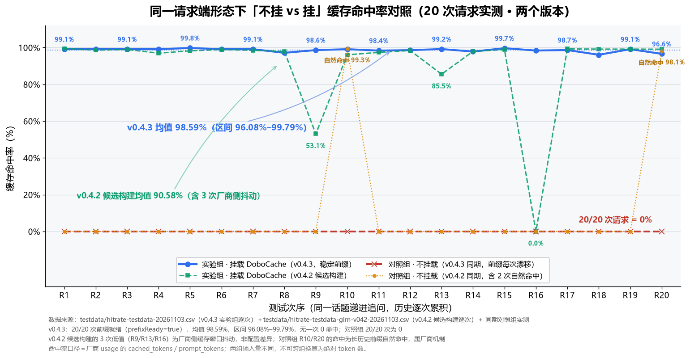
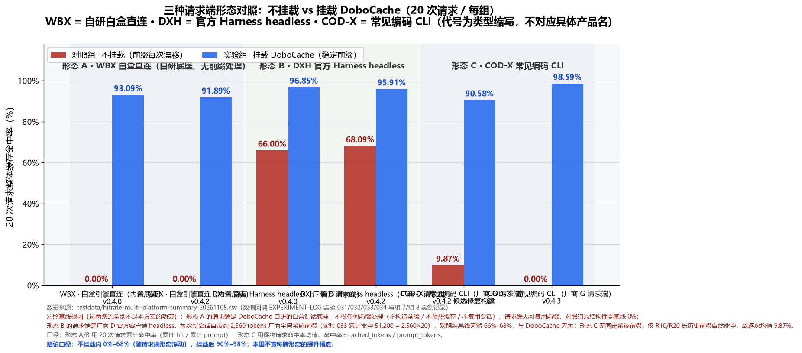

# DoboCache v0.5.0 · dobostitch: one cache core, two ways to mount

> **Stop paying full price twice for the same context.**
> DoboCache keeps the prefix of your requests stable so the **provider prompt cache you are already paying for** actually hits: the first request builds the cache, every request after that is mostly served from it. Runs entirely on your machine — no network calls, no telemetry.

### Three symptoms you have probably hit

| Symptom | What is really happening |
|---|---|
| The same session gets more expensive the longer it runs | One changed byte at the head of the request and the provider's cached prefix is **thrown away** — everything after it is billed as a miss |
| A long session suddenly "forgets" what you were doing | The client auto-compacts or trims history, and the trimmed prefix no longer lines up with the cache block boundary |
| You switch clients, or edit one character, and hits drop to zero | Timestamps, random IDs and tool-array ordering at the head are not stable |

None of this means the model is bad, and it is not really the vendor cache's fault either — **there is exactly one bottleneck: is the prefix stable?** A stable prefix already gets close to 99% on its own. DoboCache makes that happen on every request instead of by luck, and writes down what it did at each step so you can check it yourself instead of trusting a pretty number.

### 30-second start (no MCP, no client code changes, one command)

```bash
npx -y dobocache@0.5.0 dobostitch start
```

The terminal prints a line like `接入 baseURL 填：http://127.0.0.1:27880/anthropic` (use `/openai` or `/deepseek` for those vendors). Paste that into your client's **baseURL** — keys, model names and request bodies stay untouched — then work as usual. A health card shows up in the terminal, and from the **2nd request** on it carries the hit percentage.

Is it alive?

```bash
curl http://127.0.0.1:27880/__dobostitch/health     # expect {"ok":true,...}
```

- Unpacked the release zip? Just double-click `start-dobostitch.cmd` (Windows, no `npm install` needed).
- Full four steps, port fallback and the optional flags → [§6 · Mode D](#mode-d-dobostitch-local-proxy-no-client-code-changes).
- Never used a terminal? Start with the [3-minute zero-background guide](https://github.com/dobo123123/dobocache/blob/main/release/零基础三分钟上手.md).
- Your client speaks MCP? The MCP server shape (`dobocache`, 9 tools) is still there, unchanged.

### What it buys you (with conditions, not bare numbers)

Proxy shape (Option D), one ~14k-token system prompt plus 12 tool definitions, both arms byte-identical, measured at the **2nd request**:

| Scenario | Direct | Through the proxy |
|---|---|---|
| Prompt contains `current time: …`, different across two turns | 0.00% | **98.85%** |
| Field order and tool-array order shuffled | 87.39% | **98.98%** |
| Both requests byte-identical (already stable) | 98.99% | 98.99% |

Three boundaries, in plain words: these numbers hold **only** for the same vendor, the same prompt, the 2nd request; "98.85 percentage points better" is not "98.85% better hit rate"; and when the prompt is already stable it adds nothing — **and makes nothing worse**. No money is converted anywhere; raw data and re-run scripts ship with the package.

### Three things to know before installing

1. **Free, open source, no paid tier** — Apache-2.0, no subscription, no commercial licence gate;
2. **Your data stays local** — no certificate, no TLS interception, no upload; logs contain no prompt text (`req-<hash>` / `sid-<hash>`) and never leave the machine;
3. **Platform support is labelled honestly** — Windows verified end-to-end on real hardware; Linux tested in containers; macOS covered by CI smoke tests only (no long-session desktop test). No "fully supported" claim, no success-rate promise.

---

DoboCache is an **MCP server mounted over stdio**. It sits between your coding CLI / agent client and the model vendor's API, and turns each request's context into a **stable, reusable prefix that is automatically topped up when it falls below the vendor's minimum cache threshold**. Whether the cache hit, how much it hit, and what DoboCache changed along the way are all written to a local white-box log you can read at any time.

### Two shapes, one core (new in v0.5.0)

Same cache core, two ways to mount it. **Install one, not both.**

| Shape | Command | How to use | Pick it if |
|---|---|---|---|
| **A. MCP server** (unchanged) | `dobocache` | Mount a stdio server in the client's MCP config; the client decides when to call the `cf_*` tools | Your client speaks MCP and you want it to drive the bookkeeping |
| **B. Local proxy `dobostitch`** (new) | `dobostitch start` | Start a local proxy, then point the client's `baseURL` at it; every request flows through unchanged apart from prefix normalisation | You want it to just work, without touching client code or needing MCP support |

Both shapes share the same hit detection, the same per-request card and the same log format — the only difference is *who triggers* them.

- Default port `27880`; if it is taken the proxy drifts **+1 at a time** (up to 10 times). Always use the address the process prints.
- Health probe: `GET /__dobostitch/health` (not `/health`).
- Default `--rewrite stabilize`. `--rewrite anchor` is **experimental**: it freezes the timestamps the model sees at session start, so the model no longer sees real time.
- No certificates, no TLS interception, no upload. Your API key stays in your own config.


### The hard numbers first: 20 consecutive requests, controlled (same machine, same backend model, same parameters — only mounted vs not mounted)

| Requesting side | 20 requests · not mounted | 20 requests · DoboCache mounted |
|---|---|---|
| **COD-X**: Codex-family coding CLI (backend model **GLM**, i.e. "vendor G") | **0.00%** (all 20 at zero) | **98.59%** (range 96.08% – 99.79%, 20 of 20 hitting) |
| **DSH**: DeepSeek official Harness, headless (backend model **DeepSeek**, i.e. "vendor D") | 66.00% (all of that 66% comes from the ~2,560-token system prefix it carries itself) | 96.85% |
| **WBX**: this project's own white-box direct client (no prefix handling at all) | 0.00% (structural zero baseline: this client has no prefix to hit in the first place) | 93.09% |

> There is only one reading rule: **compare "mounted vs not mounted" horizontally, inside one and the same form**. Control values must not be compared across forms — how high a control arm reads is decided by whether the requesting side does its own prefix handling, not by DoboCache.
> Per-request usage, task texts and the replay script all ship in the package, so any row can be recomputed by hand → [§4 Measured results](#4-measured-results-20-consecutive-requests-controlled)

---

> **Official source**
> The only official repository for DoboCache is <https://github.com/dobo123123/dobocache>, and official releases are published only on its Releases page. Same-named projects, services, or paid editions found elsewhere are not ours. This project is free and is not sold through any third-party platform.

> **First time here?**
> - Step-by-step setup, absolute beginner level (Chinese): [零基础三分钟上手.md](零基础三分钟上手.md) — six steps from installing Node to verifying success.
> - Hit an error while installing? Search your exact error message in the [FAQ troubleshooting section](FAQ-使用须知.md) (Chinese).
>
> Cannot install or configure it? Ask in [Discussions](https://github.com/dobo123123/dobocache/discussions) — setup questions do not need an Issue.

## Platform support status (read before installing)

DoboCache is a pure-JavaScript stdio MCP server. The release bundle contains **no native binaries at all** (`.node` / `.exe` / `.dll` counts are 0), so there is no ABI-level lock-in. But "**runs**" and "**verified**" are two different claims, so this release labels each platform by how far it was actually verified:

| Platform | Status | How far it was verified |
|---|---|---|
| **Windows 10 / 11 (x64)** | ✅ **Primary platform, verified on real hardware** | End-to-end on a real machine: this 20-request controlled run (real MCP client mount + provider `usage` verification), unzip-and-run smoke test of the portable bundle, full **95** tests passing, log location observed as `%LOCALAPPDATA%\DoboCache\logs` |
| **Linux (x86_64)** | 🟡 **Verified inside a Linux container** (not a desktop machine) | On 2026-11-04 the released bundle was actually executed on Docker `linux/amd64` with the official Node Linux image: unzip-and-run, valid `initialize` / `tools/list`, all 9 tools present, `cf_judge` hitting, `cf_inject` returning `prefixReady=true`, log written to `~/.local/state/dobocache`, `XDG_STATE_HOME` honoured, `DOBOCACHE_LOG_DIR` taking highest priority, read-only directory degrading without a crash, and Node 16 aborting with `exit 1`. **Desktop Linux with a GUI client mount, and arm64, remain unverified** (details in `兼容性说明.md`, Appendix A) |
| **macOS (Intel / Apple Silicon)** | 🟡 **Smoke test passed in CI on real Mac machines** (not long-term use) | The CI macOS job runs on real Mac hardware: `npm ci` → `tsc` → `eslint` → `vitest` → MCP stdio handshake (`initialize` + `tools/list` with exactly 9 tools) → log-directory assertion (must land in `~/Library/Logs/DoboCache` with `logDirSource=platform`). Both architectures are in the matrix, Apple Silicon (`macos-latest`) and Intel (`macos-13`); see Actions for the latest all-green run. **Still missing**: long-session runs with a real desktop client (coding CLIs and the like) mounted |

**We would rather state the boundary than overclaim:**

1. Windows is the primary platform and the **only** one verified end-to-end on real hardware (real client mount + provider `usage` read-back);
2. Linux has been actually executed in a `linux/amd64` container (protocol chain, logging, read-only degradation, Node version self-check), but **a desktop distribution with a GUI client mount, and arm64, are still unverified**; on macOS, CI has run the smoke chain on real Apple Silicon and Intel machines, but **no long-session test with a desktop client has been done**. So macOS is labelled only "smoke test passed in CI" and Linux only "verified in container" — neither is labelled "fully supported". We have no real success-rate data and will not promise a percentage;
3. **Feedback welcome, and we will fix what the feedback shows**: whether it works or breaks on Linux / macOS, please tell us.

**Where to send feedback**

| Channel | How |
|---|---|
| GitHub Issues (preferred) | Prefix the title with `[platform: macOS]` or `[platform: linux]`; include `node -v`, `uname -a` (`sw_vers` on macOS), the `logDir` / `logDirSource` values from `cf_report`, and the full error text |
| The channel you got this bundle from | Until the repository is public, reply in the same channel with the same information |
| Self-check first | `FAQ-使用须知.md` §3 (where the log lives) and §7 (`prefixReady=false`) answer most "it looks like nothing happened" cases |

> **Do not paste your prompt text into an issue**: the log is already sanitised (`req-<hash>` / `sid-<hash>`); a log excerpt is enough to locate the problem.

---

## 1. The problem it addresses

Every major vendor API offers prompt caching: if the beginning of a request is byte-identical to a previous one, that portion is billed as cached instead of recomputed at full rate. In real conversations the prefix is almost never identical:

- system prompt ordering drifts, prompt concatenation order changes between requests;
- history trimming leaves the prefix misaligned with cache block boundaries (commonly 128 tokens);
- the prefix is shorter than the vendor's minimum cacheable length, so it never enters the cache at all;
- duplicated instructions and repeated document blocks make the prefix longer but dirtier.

Any single mismatch invalidates the whole cached prefix — **you believe you are using the cache while every request is recomputed at full rate**. DoboCache fixes these "almost identical" gaps one by one, and **records the reason for every adjustment**, so you can verify the work instead of trusting a single good-looking number.

## 2. The nine tools you can call (8 business tools + `ping`)

The server exposes **8 business tools plus one health check (`ping`)**. All of them run locally over stdio — no network calls, no uploads:

| Tool | Purpose | Writes to disk |
|---|---|---|
| `cf_judge` | **Hit decision**: tiered keyword matching (entity anchors / intent modifiers) → three-layer match → recency decay → negative filtering, with explainable evidence (`hit` / `score` / `evidence` / `matched`) | White-box log |
| `cf_tier` | **Value-tier admission**: distill → grade A/B/C → fill by budget from high to low, returning the admitted list and what was dropped | No |
| `cf_inject` | **Distilled memory injection**: builds a stable prefix (dedup → 128-token alignment → threshold top-up) and returns `prefix` / `tail` ready to send | White-box log; freezes session prefix (in memory) |
| `cf_warmup` | **Warm-up**: call once before the first real request to build a minimal placeholder request from the frozen prefix and trigger the vendor's prefix cache (costs a little; you must send that prompt to the LLM yourself) | No |
| `cf_report` | Cumulative white-box statistics: hit rate, raw/optimised tokens, per-session aggregation (`per_session`), plus the actual log location `logDir` / `logDirSource`; with `source="disk"` it **re-aggregates from the local log files** (survives restarts, spans days), and `days=<n>` limits the window | No (reads log) |
| `cf_meter` | Metering snapshot (token counts and relative cost ratios, never request text) | No |
| `cf_prune` | Deterministic pruning of tool output: dedup lines, collapse whitespace, char/line caps, returns the volume ratio | No |
| `cf_normalize` | Deterministic normalisation of structured results: field whitelist + stable ordering, returns a content-free key (`nk-<16-hex>`) | No |

Typical call: `cf_inject(reset=true, sessionId=<your-session>, minPrefixTokens=<vendor threshold>)`.

> Parameters are type- and range-checked at the protocol layer (e.g. `threshold ≥ 0`, `topK ≥ 1`, `maxChars ≥ 1`, `maxTokens > 0`). Out-of-range values return a standard `-32602` validation error naming the field instead of being silently accepted.

## 3. Release notes (read this first)

**v0.4.9 = a release-channel change. npm has announced that long-lived "bypass 2FA" tokens will be restricted for direct publishing starting 2027-01, so this release moves publishing to GitHub Actions OIDC Trusted Publishing: GitHub mints a short-lived OIDC token on tag push, npm validates and accepts the package, and no publishing secret is stored in the repository or its settings; artifacts also carry provenance attestations traceable to a specific commit and workflow run. No code or caching-core change: behaviour is byte-for-byte identical to v0.4.8.**

| Item | Detail |
|---|---|
| Inherited | v0.4.7's bounded logs (10MB rotation + 7-day retention by default), `cf_report`'s `source="disk"` re-aggregation, and the corrected `cf_prune` description are all kept; so are v0.4.4's `minPrefixTokens` fix and the log privacy work (`requestId` → `req-<8-hex>`, `sessionId` → `sid-<8-hex>`, `cf_normalize` key → `nk-<16-hex>`) |
| Changed in this version | ① **Charts no longer break**: both comparison charts (hit-rate comparison / three requesting-side forms) now use `raw.githubusercontent.com` absolute URLs, so the npm package page renders them. ② **Doc links no longer 404**: the nine relative links in the root README (quick start / FAQ / compatibility / SECURITY / LICENSE / English / Chinese) are now absolute GitHub URLs and are clickable from the npm page. ③ **Docs inside the portable bundle stay as they are**: `release/README.zh.md` and `README.en.md` keep same-directory relative paths — inside the bundle the docs and images sit together and work offline after unzipping; the two path styles each serve their own channel |
| Hit-related code | **No code change.** The caching core (prefix freezing / alignment / tiered admission / judge logic) is identical to v0.4.7 and `dist` behaves byte-identically; only `serverInfo.version` moves with the release number. In the default mode `cf_judge` / `cf_inject` return **one JSON block with no card** |
| Smoke test | MCP stdio smoke passed (run on win32 on 2026-11-07): `serverInfo.version = 0.4.9`, `protocolVersion = 2024-11-05`, all 9 tools present (`ping`/`cf_judge`/`cf_tier`/`cf_inject`/`cf_meter`/`cf_warmup`/`cf_report`/`cf_prune`/`cf_normalize`), a real `cf_judge` call wrote `dobocache-2026-11-07.log.jsonl`, and `cf_report` returned a valid `logDir` / `logDirSource` (`calls=1`, `hitRate=80`) |
| Tests | **95 / 95 passing**; `tsc --noEmit` clean; `eslint src test` clean |
| Platform verification | **Windows verified end-to-end on real hardware**; **Linux actually executed inside a `linux/amd64` container** (protocol chain / 9 tools / log branches / read-only degradation / Node version self-check — see "Platform support status" and `兼容性说明.md` Appendix A); macOS **smoke chain run in CI on real Apple Silicon and Intel machines**, with long-session desktop-client testing still missing |
| **Not claimed** | This is **neither a performance release nor a feature release**. Hit rates match v0.4.7 / v0.4.4 exactly; please do not read any number below as "the new version is higher" |

> Why v0.4.3 exists: in the v0.4.2 release build, step 4 of `injectIncremental` called `topUpPrefixToMin(...)` but was missing the `prefix = topUp.prefix;` assignment, so the top-up never took effect and the parameter was effectively inert. The DeepSeek family's default threshold is low (295), and normal prefixes are already longer than that, so the bug stayed hidden; the GLM family's real threshold is 1806+, where top-up is mandatory — the moment it fails, the bug shows. That is why this regression set is run against GLM. v0.4.3 added the missing assignment.

## 4. Measured results (20 consecutive requests, controlled)

This run: one progressive 20-request conversation. The requesting side was **COD-X** (a Codex-family coding CLI) with backend model **GLM**; the whitebox engine mounted DoboCache over stdio MCP. Same machine, same backend model, same parameters — the only difference is mounted vs. not mounted. This form was run for **two complete rounds of 20 requests** (groups 7 and 8), each round mounting a different version — see "Two rounds of 20, same yardstick" at the end of this section for the per-round comparison.

> **Code list (written so it can be recognised — no over-anonymising)**
>
> | Code | What it is | Backend model |
> |---|---|---|
> | **WBX** | This project's own white-box direct client (not any official client), deliberately doing no prefix handling at all — built to measure a zero baseline | — |
> | **DSH** | **DeepSeek official Harness**, headless mode | **DeepSeek** |
> | **COD-X** | **Codex-family coding CLI** | **GLM** (Zhipu) |
>
> Earlier records wrote the vendors as "vendor D" (DeepSeek) and "vendor G" (GLM); from this section on the vendor names are written out, so there is no guessing while reading the tables. Only **hit rates and relative ratios** are reported, never any monetary amount; cost-related fields are relative values converted with the price coefficients described in section 6.



| Metric | Control (not mounted) | Mounted (DoboCache) |
|---|---|---|
| Mean hit rate over 20 requests | **0.00%** (all 20 requests at zero) | **98.59%** |
| Range | — | **96.08% – 99.79%** |
| Zero-hit requests | 20 / 20 | **0 / 20** |
| Prefix ready (`prefixReady=true`) | — | **20 / 20** |
| Effective threshold `effectiveMinPrefixTokens` | — | **3450** (= 3000 × 1.15, config applied) |

### Why the control arm reads 0 — the causal chain in three sentences

1. **A different random-noise marker was injected at the head of every request**, so the opening segment differed from one round to the next;
2. The vendor's prefix cache only matches "a beginning byte-identical to last time" — **once the beginning changes, the segment already built is discarded wholesale**, and the whole request counts as a miss;
3. That drift happened on each of the 20 rounds, so all 20/20 readings were 0 and the mean is 0.00%.

So this 0 is neither "the vendor's cache is bad" nor "the control arm was sabotaged on purpose" — it is **how a prefix cache behaves when the prefix is unstable**. This 0 and WBX's 0 have different causes: WBX is a **structural zero baseline** (that client does no prefix handling at all, so it has no prefix to hit in the first place), whereas the COD-X group is **a zero under noise stress** (a prefix could have existed, but the drift scattered it). Neither is a result of DoboCache — only the "mounted vs not mounted" gap inside one and the same form is.

How to read this — all three points matter together:

1. **The control arm received different random noise at the head of every request**, deliberately drifting the prefix, which is why all 20 requests were zero. This is not "the control is bad"; it is what happens when a prefix changes and the vendor's prefix cache is invalidated wholesale.
2. **The mounted arm hit on all 20 requests**, with `prefixTokens` stable in the 3456–4480 range and `prefixReady` true on every request.
3. **A hit rate is the cached share inside that request's own input, not an absolute token saving.** The two arms have different input volumes (control grows from 39 to 2738 tokens across requests; mounted stays at "prefix + tail"), so the two must not be converted into absolute token counts, and numbers must not be mixed across experiments.

**Zoom out one level: not-mounted is not always 0%.** The hit rate is not decided by "mounted or not" alone — how the requesting side builds its requests sets the control arm's starting point. The same mounting logic was run for 20 requests under three requesting-side forms:

**First, what each requesting side actually is — this is the whole reason the control baselines differ:**

| Form | Who the requesting side is | Does it do any prefix handling itself? | Why the control arm reads what it reads |
|---|---|---|---|
| A · WBX whitebox self-built, direct | **DoboCache's own whitebox test base** — a direct client we wrote ourselves for these experiments, not any official client | **No, none at all**: no prefix construction, no cache warm-up, no session reuse; each round sends only "task text + random noise" | 0 / 28,846 tokens over 20 requests. With nothing reusable in hand, the baseline is structurally **0.00%** — a **structural zero baseline**, not a cache that "collapsed" |
| B · DSH DeepSeek official Harness, headless | DeepSeek's official client (headless mode), backend model DeepSeek | **Yes, guaranteed by both client and provider**: every new session carries ~2,560 tokens of provider-side global system prefix | 51,200 / 77,576 tokens over 20 requests = **66.00%**; 51,200 is exactly 2,560 × 20, so you can verify that all of that 66% comes from the official prefix and owes nothing to DoboCache |
| C · COD-X Codex-family coding CLI | Codex-family coding client, backend model GLM (Zhipu) | **Not fixed**: no global system prefix; hits only when long-history prefixes happen to stay stable | Group 8: zero on all 20; group 7: only R10 / R20 hit naturally, per-request mean 9.87% |

In one sentence: **A's 0% means "this client has no prefix to hit in the first place" (our own base, deliberately doing nothing, used to measure a zero baseline); B's 66% means "the official client already has a prefix underneath". Neither figure is a DoboCache result.** Both starting points say the same thing: the control arm's height is set by **how much prefix handling the requesting side does itself**. Read this table horizontally, "mounted vs not mounted" within one form — never vertically as "whose control arm is higher", and never subtract percentages across forms to claim a gain.




| Requesting-side form | Version · source run | Control (not mounted) | Mounted (DoboCache) | Notes |
|---|---|---|---|---|
| A · WBX whitebox self-built, direct | v0.4.0 · exp 031 | 0.00% | 93.09% | Our own whitebox base, no prefix handling at all (structural zero baseline) |
| A · WBX whitebox self-built, direct | v0.4.2 · exp 032 | 0.00% | 91.89% | Same |
| B · DSH DeepSeek official Harness | v0.4.0 · exp 033 | 66.00% | 96.85% | The requesting side ships ~2,560 tokens of global system-prefix cache; the control arm degrades 84.27% → 54.54% as noise accumulates |
| B · DSH DeepSeek official Harness | v0.4.2 · exp 034 | 68.09% | 95.91% | Control baseline comes from the same provider-side system-prefix cache; the mounted arm holds per-round misses down to 135–426 tokens |
| C · COD-X Codex-family coding CLI (backend GLM) | v0.4.2 candidate fix build · group 7 | 9.87% | 90.58% | Control arm measured zero on 18/20 requests; R10/R20 hit naturally via long-history prefixes |
| C · COD-X Codex-family coding CLI (backend GLM) | v0.4.3 · group 8 | 0.00% | 98.59% | The main dataset in the table above |

Three points to read:

1. **Form B's 66%–68% is not credit to DoboCache, and it does not mean "the gain is small"** — the requesting side brings its own global system-prefix cache, giving the control arm a head start; that arm degrading 84.27% → 54.54% as noise accumulates shows its cache is just as fragile.
2. **Control-arm starting points span 0% to 68% across the three forms; the difference lies entirely in how the requesting side builds requests, so cross-form control values must not be compared.** Only "mounted vs not mounted" within the same form is comparable.
3. **Once mounted, all three forms land at 90%–98%**, which shows static prefix reuse is independent of the requesting-side form rather than a quirk of one client.
4. **A caveat on the denominator, which matters more than the numbers**: forms A / B are reported on an **aggregate basis over the 20 requests** (total cached tokens ÷ total prompt tokens), while form C is the **mean of the 20 per-request hit rates** — two different estimators, so compare orders of magnitude across forms, never add or subtract their percentages. Only "mounted vs not mounted" inside the same form is same-basis.

### Two rounds of 20, same yardstick: what the later build is actually better at

The COD-X form was **run for two complete rounds of 20 requests each**, the two rounds differing only in the mounted version — the only "same form, same tasks, different version" comparison in this project:

| Round | Mounted version | Control (not mounted) | Mounted | Abnormal readings in 20 requests |
|---|---|---|---|---|
| Group 7 | v0.4.2 candidate fix build | 9.87% | 90.58% | 3 (53.08% / 85.53% / 0.00%) |
| Group 8 | **v0.4.3** | 0.00% | **98.59%** (96.08% – 99.79%) | **0** |

Both rounds built the control arm identically (a different random-noise marker at the head of each round, deliberately drifting the prefix), so "group 7 = 9.87%, group 8 = 0.00%" is **not** "newer version, worse baseline" — it is only the randomness of the noise itself:

- In group 7, requests R10 and R20 came after 10 and 19 rounds of accumulated history; the long-history prefix was long enough for the provider-side cache to match on its own, reading **99.27% / 98.10%**. The other 18 were broken up by the noise and read 0, so the 20-request mean is 9.87%;
- In group 8, the noise broke the prefix on all 20 requests, so every reading was 0 and the mean is 0.00%.

**So what exactly is "the later build is stronger" about? Three concrete things, none of which is "a higher mean":**

1. **Jitter down to zero**: 3 of group 7's 20 requests were hit by provider-side jitter (53.08% / 85.53% / 0.00%); group 8 had **not a single jitter event** across its 20 requests, `prefixReady` 20/20, and a range of 96.08% – 99.79%;
2. **A higher floor**: the worst single reading moved from **0.00%** to **96.08%**. What actually ruins the experience with a caching tool is "the occasional request that misses completely" — that went from present to absent;
3. **A real defect got fixed**: v0.4.3 restored the `prefix = topUp.prefix;` assignment that `injectIncremental` had lost after `topUpPrefixToMin(...)` — the top-up result was never wired back downstream, so the parameter did nothing. The DeepSeek family's default threshold is low (295), and normal prefixes are already longer than that, so the defect stayed hidden; **the GLM family's real threshold is 1806+, where top-up is mandatory**, so the moment it fails the defect shows. That is also why this regression set is always run on COD-X + GLM: it is the strictest gate of all.

To state it in full: **with the jitter rounds excluded, the two builds are level on the stable segment** — group 7's remaining 17 requests average **98.41%**, group 8's same-position average is **98.57%**, a difference of 0.16pp. So please do not read "90.58% → 98.59%" as "the upgrade brought 8 points"; what version iteration actually did is turn "stable" from occasional into every-request, and turn "it can drop to 0" into "it cannot drop that far". The stable-segment level is neither padded nor exaggerated. Per-request comparison: `testdata/hitrate-regression-report-20261103.md`, section 6.

**These two figures also prove something that is *not* to this tool's credit: the vendor's built-in cache is already good — as long as the prefix stays stable it can hit close to 99%.** The only bottleneck throughout is one thing: whether the prefix is stable. What DoboCache does is make the prefix stable and keep it stable on every request; it does not conjure hits out of nothing. So "0%–9.87% unmounted" is a reading under **stress conditions** — it does not mean "the vendor's cache is poor", and it must not be read as "mount it and you gain 98 points".

Unified reading: **not mounted ≈ 0%–68% (floats with the requesting-side form), mounted 90%–98%.** Every row above maps to a recorded run (experiments 031 / 032 / 033 / 034 and groups 7 / 8) and to the `source_exp` / `recompute_file` fields of the summary CSV: `testdata/hitrate-multi-platform-summary-20261105.csv` — for forms A / B the numerator and denominator ship as token columns in the same row, while form C is a per-request mean whose per-request files sit in the same folder, so any cell can be recomputed. Per-request charts and the replot script: `scripts/hitrate-comparison.py`. No cell in this table is an estimate or a rounded-up guess.

### On the size of this test set: an honest note

The numbers come from 8 controlled groups, 20 consecutive requests per formal group, plus two earlier threshold-probing groups (5 and 10 requests).

First, the boundary: **the individual requests here are all small** — every round feeds the same AI-news-roundup topic, prefixes run from a few hundred to a few thousand tokens, and both the task texts and the per-request usage ship in `testdata/`, so anyone can redo the arithmetic.

**We did not test genuinely long tasks**: single requests in the tens of thousands of tokens, whole-codebase analysis, sessions dozens of turns deep — none of that is in the sample. Whether static prefix reuse holds at that scale is untested here, and we will not claim either way.

If you happen to have work like that, mount it, run it, and tell us what you see — recorded per-request usage beats any promise we could make. That is exactly why the per-request data, the task texts and the replay steps all ship in the package: **so you can check us instead of trusting us.**

## 5. The white-box report: every step visible

After each `cf_judge` / `cf_inject`, the log records what the step did, why, and with what effect. This record is a **v0.4.9-format sample** — field names, numbers and identifiers follow the current schema; the `label` / `note` strings are **translated here for readability** — the file itself stores the original Chinese text, and the untranslated record is in `README.zh.md` §5:

```json
{
  "requestId": "req-1b0ff98f",
  "ts": 1793709231484,
  "reqIndex": 2,
  "promptChars": 36,
  "rawTokens": 201,
  "optimizedTokens": 4096,
  "hitRate": null,
  "savedTokens": null,
  "savedPct": null,
  "changes": [
    {"kind": "align128", "label": "128-token prefix alignment", "detail": "appended 98 alignment blocks"},
    {"kind": "topup",    "label": "threshold top-up", "detail": "added 63 blocks (high-value fragments / doc chunks)"},
    {"kind": "scenario", "label": "first request / empty cache: lightweight constraints"}
  ],
  "note": "cf_inject: 201 raw tokens -> 4096 optimized tokens (prefix 4096 + tail); effective threshold 3450 tokens.",
  "sessionId": "sid-b6ca1662",
  "scenario": "first",
  "mode": "rebuild",
  "alignBlocks": 98,
  "prefixTokens": 4096
}
```

Three comparison capabilities survive sanitisation: **which request** (`reqIndex`), **whether it is the same prompt** (equal `req-...` values), and **what changed** (`changes[]` + `note`). The content itself is never written.

> `hitRate: null` means **not determined for this request**, not "0% hit". `cf_inject` runs at the *injection* stage — the request hasn't been sent yet, and DoboCache never sees the provider response unless you hand it over, so it writes `null` (undetermined) instead of pretending `0`. Up to v0.4.4 it wrote `0`, which read like a zero hit rate and contradicted the CSV figures that come from provider `usage`; that ambiguity is what v0.4.6 removes. To get a real hit rate recorded, pass `hitTokens` / `missTokens` (taken from the provider's `usage`) to the call. Cumulative stats come from `cf_report`. See §1 of `FAQ-使用须知.md`.

### White-box cards are off by default (v0.4.6)

The white-box report card is written **into the conversation context**, which costs tokens (roughly 300+ tokens per card, and every tool call could carry one). Since v0.4.6:

- **Default (`quiet`)**: the report is written to the local log only, is **not returned** with the tool result, and costs no conversation tokens;
- **Want cumulative numbers**: call `cf_report` — it reads the local log and costs nothing extra;
- **Want per-call detail**: set `DOBOCACHE_WHITEBOX=` `once` (next call returns one report, then falls back to `quiet` automatically) or `always` (every call returns a report — that is the ~300+ tokens per call);
- **First run**: a one-time notice pointing at the log path and the switch; it never repeats.

| Mode | Report returned with the call | Conversation tokens | When to use |
|---|---|:---:|---|
| `quiet` (default) | No — local log only | none | everyday use |
| `once` | Once, then auto-back to `quiet` | one-off | "did it actually work?" |
| `always` | Every call | ~300+ each | running controlled experiments and reading every request |

## 6. Install and mount (four ways: A/B/C are MCP mounts, D is the local proxy)

1. Unzip `dobocache-v0.5.0-portable.zip` (bundles `dist` and a **production-only** `node_modules`; no `npm install` needed, and no native `.node` binaries, so a different machine or OS will not fail on an ABI mismatch);
2. Add a **stdio** MCP server in your client's config (pick one of A / B / C below — or skip MCP entirely and use **Mode D**, which needs no client config JSON at all);
3. Restart the client and confirm **9 tools** appear (`ping` plus `cf_judge` / `cf_tier` / `cf_inject` / `cf_warmup` / `cf_report` / `cf_meter` / `cf_prune` / `cf_normalize`). A missing tool means the server did not start — check the client log for the server's stderr.

> **Prerequisite**: Node.js **18 or newer**. The process self-checks at startup and, if the version is too old, prints one plain-language message and exits (no silent failure).
> **General advice**: always put **absolute paths** in the config. Clients do not hand your shell's working directory or PATH to the spawned server, and a bare `node` or a relative path is the single most common cause of failure.

### Mode A: absolute `node` + entry js (recommended)

Windows:

```json
{
  "mcpServers": {
    "dobocache": {
      "command": "C:\\Program Files\\nodejs\\node.exe",
      "args": ["C:\\path\\to\\dobocache\\dist\\index.js"]
    }
  }
}
```

macOS / Linux:

```json
{
  "mcpServers": {
    "dobocache": {
      "command": "/usr/local/bin/node",
      "args": ["/Users/<you>/dobocache/dist/index.js"]
    }
  }
}
```

- **Use when**: unzip-and-run convenience, offline or intranet machines, or clients launched from a non-login user / unusual working directory.
- **Finding node**: `where node` on Windows; `which node` on macOS / Linux (Homebrew: `/opt/homebrew/bin/node` or `/usr/local/bin/node`; with nvm, use the absolute path inside the version directory).
- Needs no `npm` and no network — the most robust mode across machines.

### Mode B: one-shot `npx -y`

> ℹ️ **Channel note**: Modes B and C require the version to be available on the npm registry. If `npm view dobocache` returns `404` (not published yet, or a mirror has not synced), use Mode A (portable zip) instead — behaviour, content and logs are identical, and no config change is needed.

```json
{
  "mcpServers": {
    "dobocache": {
      "command": "npx",
      "args": ["-y", "dobocache@0.5.0"]
    }
  }
}
```

- ⚠️ **On Windows you must write `npx.cmd`** (`"command": "npx.cmd"`). npm installs only `npx.cmd` on Windows — there is no `npx.exe` — so a client calling `spawn("npx")` fails with `ENOENT`. This is the most frequent MCP-on-Windows error.
- On macOS / Linux keep `npx`; if the client spawns through a non-login shell whose PATH lacks node, use an absolute path such as `/usr/local/bin/npx`.
- **Use when**: you want automatic version tracking, the machine is online, and you would rather not extract a zip.
- **Caveat**: the version must be resolvable on npm (`npm view dobocache@0.5.0 version` should return a version); otherwise use Mode A. `npx` also caches; if an upgrade appears not to take effect, run `npm cache clean --force` or switch to Mode C.

### Mode C: global install, call the command directly

```bash
npm install -g dobocache@0.5.0
```

```json
{
  "mcpServers": {
    "dobocache": {
      "command": "dobocache"
    }
  }
}
```

- ⚠️ **Same extension caveat on Windows**: write `"command": "dobocache.cmd"`. If the client still cannot find it, use the absolute path of the installed launcher (the `dobocache.cmd` inside the directory whose parent `npm root -g` reports).
- **macOS / Linux permission errors**: `npm install -g dobocache@0.5.0 --prefix ~/.npm-global`, then point the config at `/Users/<you>/.npm-global/bin/dobocache`.
- **Use when**: one machine, long-term use, no repeated downloads. Upgrade by re-running `npm install -g dobocache@<new version>` and restarting the client.

Comparison:

| Mode | Needs network | Needs npm | Path control | Upgrade | Best for |
|---|:---:|:---:|---|---|---|
| A absolute node | No | No | Highest (hard-coded) | Swap folder / edit config | **Recommended**: portable zip, offline, intranet |
| B `npx -y` | Yes | Yes | Medium (npm decides cache dir) | Change version / automatic | Trials, following releases |
| C global install | Yes, at install | Yes | Medium | Re-run install | Single machine, long-term |

> **Running `npm test` / `npm run lint`?** The portable package ships production dependencies only — run `npm install` once inside the extracted folder (network required) to pull in the dev dependencies first.

**Log directory** (since v0.4.4 it no longer depends on the process working directory, so any cwd a client spawns from works):

| Platform | Default log directory |
|---|---|
| Windows | `%LOCALAPPDATA%\DoboCache\logs` (e.g. `C:\Users\<you>\AppData\Local\DoboCache\logs`) |
| macOS | `~/Library/Logs/DoboCache` |
| Linux | `$XDG_STATE_HOME/dobocache` (falls back to `~/.local/state/dobocache`) |

Priority: `DOBOCACHE_LOG_DIR` environment variable > platform default > `<cwd>/data/logs` (fallback) > if none is writable, no file is written, one warning goes to stderr, and the process keeps running. The directory actually used is reported as `logDir` / `logFile` by `cf_report`.

Where the target vendor's threshold is clearly higher than the default (some vendors require 1806+), pass `minPrefixTokens` to `cf_inject`, e.g. `minPrefixTokens=3000`. The effective threshold is that value × 1.15 (safety margin).

**All environment variables** (every one is optional; omit it and the default applies):

| Variable | Purpose | Default | Notes |
|---|---|---|---|
| `DOBOCACHE_LOG_DIR` | White-box log directory | Platform default (table above) | **Use an absolute path**; a relative path resolves against the server process's cwd, so the result is unpredictable |
| `DOBOCACHE_HIT_PRICE_PER_M` | Cache-hit price coefficient | `0.014` | Used by `cf_meter` / `cf_report` for relative cost conversion; **must be a finite number ≥ 0**. An invalid value (`abc`, `-1`) falls back to the default and prints one stderr warning |
| `DOBOCACHE_MISS_PRICE_PER_M` | Cache-miss price coefficient | `0.5` | Same as above |
| `CACHEFORGE_LOG_DIR` / `CACHEFORGE_HIT_PRICE_PER_M` / `CACHEFORGE_MISS_PRICE_PER_M` | Backward-compatible aliases | — | Pre-rename names still work; `DOBOCACHE_*` wins when both are set |

> **Replace the price coefficients with your own contracted numbers.** The shipped defaults only express the **relative** hit-vs-miss ratio (roughly 1:36); they are not any vendor's real price. The `Usd` in `savedUsd` / `cumSavedUsd` is a historical field name — the value is "relative cost converted at the current coefficients". Changing the coefficients scales the whole curve proportionally and does not affect the hit rate.

### Mode D: dobostitch local proxy (no client code changes)

Modes A / B / C all assume your client speaks MCP and an agent decides when to call a tool. Mode D sits somewhere else entirely: **the proxy runs between your client and the vendor API**, so every request passes through it whether or not anyone remembers to invoke anything. Your client only changes its `baseURL` — API key, model name and request body stay byte-for-byte identical. MCP support is irrelevant.

**1. Start the proxy** (any one source):

```bash
npx -y dobocache@0.5.0 dobostitch start        # if npm already serves this version
dobostitch start                                # after a global install
```

Unpacked the release zip? Double-click `start-dobostitch.cmd` (Windows, no `npm install` needed).

It prints the address to fill in — **use exactly that line and that port**:

```
接入 baseURL 填：http://127.0.0.1:27880/anthropic
```

Default port is `27880`; if it is taken the proxy walks upward one at a time (`27881`, `27882`, …, max 10 tries) and the printed address follows. **Trust the terminal, not your memory.**

**2. Pick the path prefix for your client's dialect**

| Client dialect | Fill in `baseURL` with |
|---|---|
| Anthropic-style | `http://127.0.0.1:27880/anthropic` |
| OpenAI-style | `http://127.0.0.1:27880/openai` |
| DeepSeek official | `http://127.0.0.1:27880/deepseek` |

Whether a trailing `/v1` is required differs per client — follow that client's docs; a 404 usually means add one and retry.

**3. Optional flags**

| Flag | Default | Effect |
|---|---|---|
| `--port <n>` | `27880` | Change the listening port |
| `--rewrite <off\|observe\|stabilize\|anchor>` | `stabilize` | `off` forwards without touching anything; `observe` inspects only, no rewriting (use for control arms); `stabilize` normalises key order and re-sorts the tool array; `anchor` additionally pins time literals (**experimental**) |
| `--inject-usage <on\|off>` | `on` | For OpenAI-dialect streaming requests, adds `stream_options.include_usage`; without it usage is usually absent and the hit rate can only be reported as "undetermined" |
| `--token <value>` / `--require-token` | off | Adds an entry check on the local proxy; worth enabling on a shared machine |

**4. Check it is alive**: open `http://127.0.0.1:27880/__dobostitch/health` (adjust the port). A JSON body containing `"ok": true` and `rewriteMode` means it is fine; it also lists the upstream host behind each of the three routes.

**5. Check it is working**: ask one question as usual — a card appears in the terminal.

```
【DoboCache 体检卡 A】第 1 次请求 · <vendor>（<dialect>）
上游：<host>（路由 /anthropic）
输入 …
```

From the second request on, read the hit percentage off the card. **The first request is always low** — the vendor has to write this turn's prefix into the cache first.

**Measured** (one ~14k-token system prompt + 12 tool definitions, both arms byte-identical, 2nd request):

| Scenario | Direct | Via proxy | Delta |
|---|---|---|---|
| S1 static baseline (requests byte-identical) | 98.99% | 98.99% | **0.00 pp** |
| S2 timestamp jitter (`current time: …` differs per turn) | 0.00% | **98.85%** | **+98.85 pp** |
| S3 structural jitter (field order and tool-array order shuffled) | 87.39% | **98.98%** | **+11.59 pp** |

How to read this: these are hit rates for the same vendor, the same prompt, the 2nd request — not a promise about your session, and not a money figure. S1 is the honest part: if your prompt is already stable, Mode D adds nothing and takes nothing away.

## 7. Privacy: your prompt text is not in the log

Since **v0.4.4**:

- `requestId` stores only `req-<8-hex>` (fixed salt + 64-bit fingerprint) — **stable for identical text, not reversible**;
- `sessionId` stores only `sid-<8-hex>`;
- the `cf_normalize` key stores only `nk-<16-hex>`;
- two numeric-only fields `round` (request index; renamed `reqIndex` in v0.4.6) and `promptChars` were added, preserving comparability without content;
- writes go through a field whitelist, so future fields carrying text still cannot reach the log;
- **the log stays local and is never uploaded**; the default location is the platform log directory (Windows `%LOCALAPPDATA%\DoboCache\logs`, macOS `~/Library/Logs/DoboCache`, Linux `~/.local/state/dobocache`), and it is never bundled with the package.

Before and after, same record:

| Field | v0.4.3 and earlier | v0.4.4 |
|---|---|---|
| `requestId` | `Summarise the main AI developments in October 2026, grouped by vendor and direction.::1793718183368` | `req-ec142df8` |
| `sessionId` | `CustomerA-2026Q4-ProjectX` | `sid-8a0a11e6` |
| `reqIndex` / `promptChars` | absent | `1` / `36` |
| Other numeric fields | original values | **identical** |

> ⚠️ **Historical logs are still yours to clean up**: v0.4.4 cannot retroactively rewrite files produced by earlier versions. If `data/logs/*.jsonl` from v0.4.3 or earlier exists on your machine (older builds wrote it under whatever directory they were launched from), its `requestId` still contains prompt text — delete or archive it as your policy requires.

## 8. Client compatibility

Only statements backed by official documentation or a clear source are included; anything unverified is marked "unconfirmed", with no speculation.

| Client | stdio MCP | Custom OpenAI-compatible `base_url` | Forced private protocol | Cache usage visibility |
|---|:---:|:---:|---|---|
| Claude Desktop | ✅ (JSON config) | Unconfirmed (no endpoint field in docs) | Vendor's own API protocol | Unconfirmed |
| Cursor | ✅ (`.cursor/mcp.json`) | ❌ Not supported: official vendor keys only, **no `base_url` field** | None, but effectively official endpoints only | Unconfirmed |
| Cline | ✅ | ✅ (Base URL + API key + model ID) | No (`/v1/chat/completions`) | Unconfirmed |
| Continue | ✅ (yaml / json) | ✅ (`provider: openai` + `apiBase`) | No | Unconfirmed |
| Codex CLI | ✅ (`~/.codex/config.toml`) | ✅ (`base_url` / `env_key` / `wire_api` under `[model_providers]`) | Optional: `wire_api` is `chat` or `responses` | ✅ telemetry carries `cached_token_count` (`responses` only) |
| Gemini CLI | ✅ | Unconfirmed (Gemini / Vertex ecosystem) | Yes (Gemini protocol) | ✅ cached tokens via `/stats` (API key / Vertex only) |
| Cherry Studio | ✅ (UI: stdio/SSE/HTTP) | ✅ (custom provider: key + endpoint) | No (OpenAI-compatible optional) | Unconfirmed |
| Trae | ✅ (UI JSON or project `.trae/mcp.json`) | ✅ (OpenAI Chat Completions + custom request URL) | No | Unconfirmed |
| Windsurf | Unconfirmed | Unconfirmed | Unconfirmed | Unconfirmed |

How to read it:

- **Mounting (stdio MCP)**: 7 of the 8 clients above document stdio configuration; Windsurf could not be verified and is left out of the supported list for now.
- **Adopting Mode D (local proxy)**: any client with ✅ in the `base_url` column can use it as-is — Cline / Continue / Codex CLI / Cherry Studio / Trae. **Cursor cannot** (no endpoint field), so Cursor users should take MCP Mode A/B/C instead. Claude Desktop / Gemini CLI: unconfirmed.
- **Whether requests can be pointed at your OpenAI-compatible endpoint**: 5 support it explicitly (Cline / Continue / Codex CLI / Cherry Studio / Trae); **Cursor cannot use a custom endpoint**; **Claude Desktop and Gemini CLI show no compatible endpoint entry in their docs**.
- **Where cache-hit data is visible**: only 2 have documentation-level evidence, and **neither is "the client panel shows cache hit rate"** — Codex CLI exposes it as an OTel telemetry field, Gemini CLI via `/stats`. This document therefore **does not claim that clients display cache hit rates in their panels**. The accurate statement is: **DoboCache reads the cache fields of the vendor API's usage response on the server side and records and returns them**; per-client visualisation needs to be verified case by case.

The full version (config paths and formats per client, 18 source links, unconfirmed list) is in `兼容性说明.md` (Chinese).

## 9. How to reproduce

Every number here ships in `testdata/`, so you can check and re-run it:

| File | Purpose |
|---|---|
| `testdata/hitrate-regression-report-20261103.md` | This run regression report: setup, all 20 requests, criterion-by-criterion verdicts |
| `testdata/hitrate-task-inventory-20261103.md` | The 20 task prompts verbatim, parameters of all 8 experiment groups, re-run notes |
| `testdata/hitrate-testdata-20261103.csv` | Per-request data (`round,text_type,raw_tokens,opt_tokens,hit_rate,saved_tokens,platform`; `round` is a legacy column name meaning "which request") |
| `testdata/复跑说明.md` | Re-run procedure, acceptance criteria, four common pitfalls (Chinese) |
| `scripts/hitrate-comparison.py` | Redraws the chart from that CSV: `python scripts/hitrate-comparison.py` |

Shortest path to reproduce:

1. Unzip v0.4.9 and point your MCP config at `<extract-dir>\dist\index.js`;
2. Mounted arm: `cf_inject(reset=true, sessionId=<new session>, minPrefixTokens=<vendor threshold>)`, then send the 20 requests from the task inventory;
3. Control arm: identical task text, but **inject different random noise at the head of every request** (see below);
4. Take the **second** request's vendor usage on each request (the first builds the cache, the second is the measurement);
5. Acceptance: `prefixReady=true` in the log and `effectiveMinPrefixTokens = configured threshold × 1.15`; the mounted arm should stay above 90%, the control mostly at 0.

> ⚠️ **Re-run must-read**: if the control arm does not get random noise on each request's prefix, the vendor's automatic prefix cache will make the control **hit as well**, and the comparison becomes meaningless. This is the step most easily done wrong.

## 10. Known limitations and non-commitments

Read this before installing. Each item below is a **capability boundary**, not a to-do.

**1. Hits require a byte-stable prefix — this tool cannot guarantee it for you**

A cache hit depends on whether the request prefix (system prompt, tool list, message order, header fields) is identical to the previous request. If your client injects timestamps, random IDs, or a changing tool set into the head, or reorders history, hit rate drops. `cf_inject` can normalise the parts you control, but it **cannot stop a client from altering the prefix**, and cannot force a hit after the fact.

**2. The provider must support prefix caching and have it enabled**

Providers differ in the minimum cacheable prefix length (this project's measurement convention uses "configured threshold × 1.15" as the effective threshold). If the endpoint does not support prefix caching, or it is disabled on the account, the hit rate is zero. **This tool does not change provider behaviour and cannot create hits on a provider that does not support them.**

**3. It reads usage fields the provider already returns — it does not estimate**

Hit figures come from the cache fields in the provider's API usage response. **When the client or provider does not return that field, the number is simply absent from the report** — this project shows "undetermined" rather than estimating a flattering figure from character counts.

**4. `savedUsd` / `cumSavedUsd` are relative values, not a bill**

The bundled default price coefficients exist only for relative hit-vs-miss comparison. They are not any vendor's real rate, and the `Usd` in the field names is historical naming. Substitute your own contract coefficients if you need money; hit rate is unaffected by the coefficients.

**5. No semantic cache, no cross-session content reuse**

This tool does not proxy, forward, or store your prompt text, and does not reuse content at a similarity or semantic level. Asking the same question in different words is not counted as a hit.

**6. Transport is stdio MCP only**

The current package provides stdio mounting only. No HTTP / SSE form. Items marked "undetermined" in the client compatibility table (including Windsurf) have no official documentation behind them: **they are not on the supported list, and no effectiveness claim is made for them.**

**7. The test set is small — this is not a benchmark**

The figures in section 4 come from a controlled 20-request experiment (same-shape plus four request shapes) and are reproducible, but **they are not a prediction for your workload**. See "On the size of this test set".

**8. What is explicitly not promised**

No promise is made about: a specific hit rate, a specific saving ratio or amount, results on any given provider/client combination, the size of any advantage over other caching approaches, or downstream business outcomes. Whether hits occur depends on your request shape and provider policy. **What this tool provides is a controllable stable prefix, admission judgement, and verifiable measurement — not a performance guarantee.**

**9. Switching clients or upgrading requires re-observation**

Changing the client, upgrading the package, or editing the system prompt or tool list invalidates the previously established cache prefix; re-observe per section 9. **Log files produced by older versions are not rewritten or deleted automatically** — clean them up yourself.

## 11. FAQ

Does `hitRate=null` mean it is broken? Why no hit on the first request? Where is the log and how do I read it? Do I need to clean logs when moving machines? See [`FAQ-使用须知.md`](FAQ-使用须知.md) (Chinese).

---

## Statement of disclosure discipline

This README and its companion materials follow one shared disclosure policy:

1. **Host named, not judged**: the requesting side under test and the backend model are labelled in a recognisable way — **COD-X** = Codex-family coding CLI (backend **GLM**), **DSH** = DeepSeek official Harness headless (backend **DeepSeek**), **WBX** = this project's white-box direct client. Writing out who it is exists so that others can reproduce the run; it does not mean we rank any third-party product better or worse;
2. **No monetary figures**: only hit rates and relative ratios — no cost numbers anywhere;
3. **No claim of improvement without a control**: v0.4.9 is a release-channel change whose caching core matches v0.4.8, described as "cache behaviour identical to v0.4.8"; where versions differ, only recomputable measured facts are stated (jitter count, floor, stable-segment values — see §4 "Two rounds of 20, same yardstick"), never unwitnessed phrasing like higher / faster / stronger;
4. **No mixing**: numbers from different experiments, integration paths or vendors are never compared directly.


---


---

## License

DoboCache is released under the **Apache License 2.0**. The full text ships in [LICENSE](../LICENSE) at the repository root and is also available at <https://www.apache.org/licenses/LICENSE-2.0>.

What that means for you:

- **Commercial use is allowed.** Use, modify, and redistribute DoboCache inside your company, in a commercial product, or behind a paid service — no fee, no license request, no notification required.
- **Closed-source derivatives are allowed.** You may embed it in a proprietary product, provided you keep the copyright and license notices and state the changes you made to modified files.
- **Express patent grant.** Section 3 of the Apache License 2.0 includes an express patent license from contributors, which matters if you are shipping this in a commercial setting.
- **No warranty.** The software is provided "AS IS", without express or implied warranties. You use it at your own risk.
- **Trademarks and names are reserved.** The license does **not** grant rights to the "DoboCache" name, the project name, or associated logos (Apache-2.0, Section 6). Fork it, ship it, build on it — just don't present your fork, service, or product as the official DoboCache release, and don't claim endorsement. Saying "based on DoboCache" is both allowed and appreciated.

## Pricing

DoboCache is a free and open-source project. There is **no paid tier, no subscription, no commercial license gate, and no plan to charge for it**. If commercial add-ons ever appear, they will be separate offerings and will not change the rights you already have under Apache-2.0 in this repository.

For **commercial partnerships, custom development, or enterprise support**, reach the author via the repository Issues. Such engagements are separate services and do not alter any right you already hold under Apache-2.0.

## Third-party components

This project depends on third-party open-source packages. Their licenses and notices are retained in the respective package directories (for example `node_modules/<package>/LICENSE`). Those licenses are **not** replaced or overridden by this project's Apache-2.0 license — keep them intact when you redistribute.

---

### Copyright and notice files

- `LICENSE` — the unmodified Apache License 2.0 text
- `NOTICE` — project name, copyright year, and trademark statement (retained on redistribution as required by Apache-2.0, Section 4(d))
